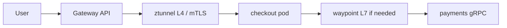

The required chapter explains Pods, Services, and Deployments. This optional lesson is the 2022–2026 *application networking* layer on top: **Gateway API** (GA October 2023; mesh + GRPCRoute in v1.1, May 2024), **Istio ambient mode** (GA in Istio 1.24), and **eBPF** data planes (Cilium). CNCF’s 2024 survey is important here: Kubernetes is ubiquitous (**80%** production), but **service mesh production use fell from 50% to 42%**—complexity is a first-class topic, not a footnote.

Once an organization grows from five microservices to fifty, every team starts reinventing the exact same networking plumbing in five different programming languages: mutual TLS (mTLS) certificates, retries with exponential backoff, circuit breakers, canary traffic splitting, and distributed tracing headers. A **Service Mesh** pulls that cross-cutting L4/L7 reliability and security logic out of application code and into the infrastructure layer. Between 2022 and 2026, two major shifts reshaped how teams adopt this stack: the Kubernetes **Gateway API** replaced fragmented Ingress annotations with a role-oriented standard, and **sidecarless / eBPF data planes** began eliminating the heavy memory tax of running an Envoy proxy inside every single Pod.

## Background Knowledge Map: Data Planes, Control Planes, and Kernel-Level Networking

### 1. Sidecar Proxies and Zero-Trust mTLS
In the classic service mesh model (Istio sidecar, Linkerd), an admission webhook injects a lightweight proxy container (e.g., Envoy) into every application Pod and redirects all inbound/outbound TCP traffic through it via `iptables`. The control plane issues short-lived **SPIFFE/SPIRE X.509 certificates** so every Pod-to-Pod call is automatically encrypted and mutually authenticated—turning a flat cluster network into a **zero-trust** fabric without touching application code.

### 2. Kubernetes Gateway API: Separating Roles Clearly
The legacy `Ingress` resource crammed TLS certificates, routing rules, and vendor-specific annotations into one YAML file. The **Gateway API** splits responsibilities cleanly across three personas: infrastructure teams define **`GatewayClass`**, cluster operators manage **`Gateway`** (listeners, ports, TLS), and application developers attach **`HTTPRoute` / `GRPCRoute`** resources with native support for weighted canary splits and header matching.

### 3. eBPF and Sidecarless (Ambient) Data Planes
Traditional `iptables` evaluates linear rule chains and forces every packet through multiple TCP/IP stack traversals between the app container and its sidecar. **eBPF (Extended Berkeley Packet Filter)** lets verified, sandboxed programs run directly inside the Linux kernel socket layer—short-circuiting socket-to-socket traffic and enabling node-level L4 encryption daemons (like Istio Ambient `ztunnel` or Cilium) that serve all Pods on a node without injecting a proxy into each one.

### Deep-Dive Explanation: Hand-Calculating Sidecar Memory & Latency Tax vs. Per-Node eBPF/Ambient Mesh (Read Slowly)

Consider a medium-sized production cluster running **500 microservices** with **2 replicas each** (**1,000 Pods** total) distributed across **20 worker nodes**.

1. **Cluster-wide RAM overhead:**
   - **Classic Sidecar Mesh** (suppose each Envoy sidecar uses **50 MiB** RAM):
     $$1{,}000\text{ Pods} \times 50\text{ MiB} = 50{,}000\text{ MiB} \approx 48.8\text{ GiB of RAM}$$
     just to run proxies—equivalent to **3 extra 16 GiB worker nodes** dedicated purely to mesh overhead!
   - **Node-level L4 Daemon / eBPF** (1 shared daemon per node at **80 MiB** RAM):
     $$20\text{ nodes} \times 80\text{ MiB} = 1{,}600\text{ MiB} \approx 1.56\text{ GiB of RAM}$$
     —a **31.25× reduction** in baseline mesh memory footprint!

2. **End-to-end latency amplification across a 4-hop microservice call chain:**
   Suppose each Pod-to-Pod call traverses an outbound sidecar + inbound sidecar, adding **1.5 ms** of proxy serialization overhead per hop:
   - Across **4 sequential hops**: $$4 \times 1.5\text{ ms} = +6.0\text{ ms}$$ added to every request before business logic even runs.
   - If you also add automatic mesh retries without care (e.g., 3 attempts at each of 4 layers), a failing leaf service can suffer a **retry storm** of up to $$3^4 = 81\times$$ normal traffic!

Calculating both the RAM bill and the hop multiplier up front helps you choose where you genuinely need full L7 Envoy proxies versus lean L4 mTLS + Gateway API.

## Learning objectives

- Replace “Ingress object forever” with Gateway / HTTPRoute / GRPCRoute as the north–south contract.
- Contrast sidecar mesh vs ambient (ztunnel + optional waypoints).
- Decide when eBPF CNI policy is enough and when you still want L7 mesh policy.

## 1. Gateway API as the portable SOA edge

Gateway API v1.0 (31 October 2023) graduated `Gateway`, `GatewayClass`, and `HTTPRoute`. v1.1 (9 May 2024) moved **service-mesh use** (HTTPRoute `parentRef` to a Service) and **GRPCRoute** to the Standard channel. One route object can describe both ingress and east–west intent.

```yaml
apiVersion: gateway.networking.k8s.io/v1
kind: HTTPRoute
metadata:
  name: checkout
spec:
  parentRefs:
    - name: edge-gateway
  rules:
    - matches:
        - path: { type: PathPrefix, value: /checkout }
      backendRefs:
        - name: checkout
          port: 8080
```

Application teams own *routes*; platform teams own *Gateways*. That split is the SOA governance model Kubernetes was missing when everyone shared one giant Ingress controller annotation dialect.

## 2. Ambient mesh: mTLS without a sidecar tax

Istio ambient (announced 2022, **GA in 1.24**, late 2024) puts L4 in a node **ztunnel** and optional L7 in **waypoint** proxies. Goal: cryptographic identity and golden-signal telemetry *without* a sidecar in every Pod (the operational complaint behind the CNCF adoption dip).

Cilium (also CNCF graduated) implements much L3/L4 in **eBPF** and can add L7 via Envoy. Istio’s 2024 comparison notes the two are often **combined**: Cilium for CNI/NetworkPolicy, Istio for L7 and identity. Students should not treat them as mutually exclusive brands.



## 3. When *not* to add a mesh

Add a mesh when you need **portable identity** (SPIFFE), consistent timeouts, or L7 authz across languages. Skip it when you have three services and a single Ingress—CNCF’s drop from 50%→42% is a warning, not a failure of the idea.

<div class="content-box warning-box">
<p><strong>Mesh is not observability.</strong> You still need OpenTelemetry inside the app for business spans. The data plane gives you golden signals; it does not know <code>order.id</code>.</p>
</div>

## Challenges

- Two traffic APIs in one cluster (legacy Ingress + Gateway + VirtualService).
- Ambient + kube-proxy-replacement CNIs need documented flags so socket load-balancing does not bypass the mesh.
- GRPCRoute support lags HTTPRoute in some implementations—check the controller matrix.

## Video tham khảo

- **xem trước:** [Istio & Service Mesh - simply explained in 15 mins](https://www.youtube.com/watch?v=16fgzklcF7Y) — TechWorld with Nana, English. Watch first: what a service mesh is, before the lesson’s ambient-mode and “when not to add a mesh” sections.
- [The Differences between Ingress & Gateway API](https://www.youtube.com/watch?v=GhIrz-V9X6k) — That DevOps Guy, English. Ingress versus the Gateway API, the portable edge the lesson’s first section describes.
- [What is Cilium?](https://www.youtube.com/watch?v=ELyib78vjRY) — eBPF & Cilium Community, English. What Cilium is, the eBPF data plane the lesson names beside Istio.

## Exercises

1. Rewrite a simple Ingress YAML as Gateway + HTTPRoute. Who owns each object?
2. For a gRPC payments API, argue for GRPCRoute vs. HTTP/JSON at the edge.
3. Using the CNCF 2024 numbers, write a one-paragraph recommendation to a dean’s office: mesh or not for a 15-service campus system.

## References

1. Kubernetes blog, “Gateway API v1.0: GA Release” (31 Oct 2023): [kubernetes.io/blog/2023/10/31/gateway-api-ga](https://kubernetes.io/blog/2023/10/31/gateway-api-ga/).
2. Kubernetes blog, “Gateway API v1.1” (9 May 2024): [kubernetes.io/blog/2024/05/09/gateway-api-v1-1](https://kubernetes.io/blog/2024/05/09/gateway-api-v1-1/).
3. Istio, “Ambient Mode Reaches General Availability in v1.24”: [istio.io/latest/blog/2024/ambient-reaches-ga](https://istio.io/latest/blog/2024/ambient-reaches-ga/).
4. Istio, “Istio Ambient vs. Cilium” (2024): [istio.io/latest/blog/2024/ambient-vs-cilium](https://istio.io/latest/blog/2024/ambient-vs-cilium/).
5. CNCF *Cloud Native 2024 Annual Survey* (80% K8s; mesh 42%): [cncf.io/reports/cncf-annual-survey-2024](https://www.cncf.io/reports/cncf-annual-survey-2024/) and [PDF](https://www.cncf.io/wp-content/uploads/2025/04/cncf_annual_survey24_031225a.pdf).
