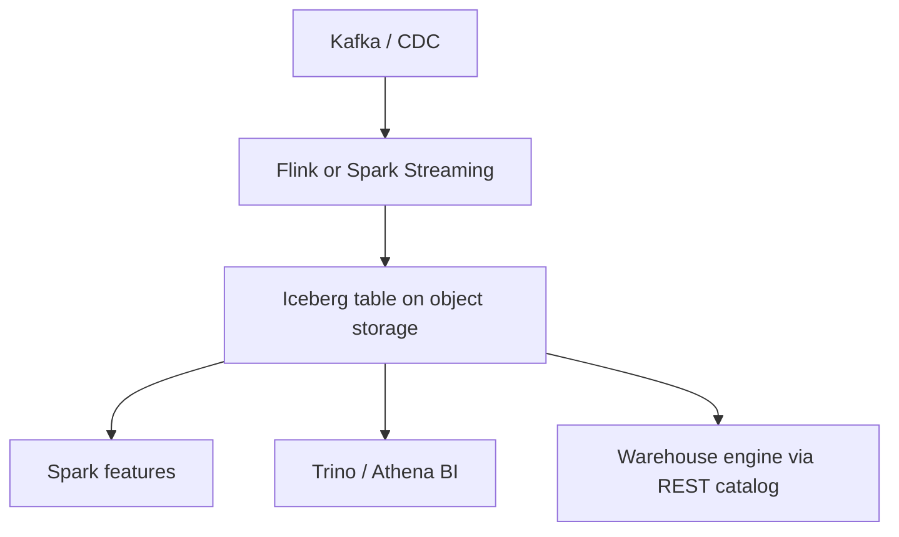

The required chapter defines platforms, pipelines, and Lambda/Kappa processing. This optional lesson is the 2022–2026 **open lakehouse** application: one copy of data in object storage, **Iceberg/Delta/Hudi** table metadata, and many engines (Spark, Flink, Trino, warehouse SaaS) sharing a **REST catalog**.

For years, data teams lived in a split-brain world: cheap **data lakes** (raw files dumped into S3 or GCS) handled unstructured data and machine learning but lacked ACID transactions and routinely turned into untrustworthy "data swamps," while proprietary **data warehouses** delivered crisp SQL governance and fast BI dashboards at steep storage-and-compute lock-in costs. The **Open Lakehouse** architecture (2022–2026) merges both worlds by layering an open transactional metadata log (**Apache Iceberg**, **Delta Lake**, or **Apache Hudi**) directly over open columnar files (**Apache Parquet**) in cheap cloud object storage—letting Spark, Trino, DuckDB, and Python ML frameworks all query the exact same single source of truth safely.

## Key ideas: Columnar Storage, Open Table Formats, and Multi-Engine Interoperability

### 1. Columnar Files (Apache Parquet) and Vectorized Scanning
Row-oriented formats (CSV, JSON) force an analytics engine to read every single column of every row just to average one `price` field. **Apache Parquet** stores values column by column in compressed row groups along with **min/max statistics** in the file footer. Queries skip unneeded columns (**column projection**) and skip entire row groups whose min/max bounds cannot match the `WHERE` filter (**predicate pushdown**).

### 2. Open Table Formats: Bringing ACID Transactions to Object Storage
Cloud object stores like S3 only guarantee atomic single-object puts, not multi-file table updates. **Apache Iceberg** and **Delta Lake** add an immutable **metadata manifest / transaction log** alongside the Parquet files. A writer stages new Parquet files and commits a single atomic pointer swap to the new snapshot—giving readers **snapshot isolation**, **time-travel queries** ("query the table as of yesterday at 14:00"), and safe **schema evolution** without rewriting terabytes of history.

### 3. Decoupled Multi-Engine Compute
Because table metadata and Parquet files follow open specifications, no single vendor holds your data hostage. A batch ETL pipeline can write with **Spark**, an interactive dashboard can query with **Trino**, and a data scientist can prototype locally on a laptop with **DuckDB**—all reading the exact same Iceberg/Delta snapshot with zero ETL duplication.

### Explanation: Hand-Calculating How Partition Pruning + Columnar Projection Slash Query I/O by 869×

Imagine an Open Lakehouse sales table totaling **1,000 GB (1 TB)** stored in Parquet, spanning **365 daily partitions** (1 full year) and **50 equally sized columns**. An analyst runs a weekly revenue report filtering to the **last 7 days** and selecting only **3 columns** (`order_date`, `region`, `amount`).

Let's compute the bytes scanned step by step:
1. **Naive full-table row scan (e.g., unpartitioned CSV/JSON):**
   $$\text{Data scanned} = 1{,}000\text{ GB}.$$
2. **After Partition Pruning (Iceberg/Delta manifest skips 358 of 365 daily partitions):**
   $$\text{Data remaining} = 1{,}000\text{ GB} \times \frac{7}{365} \approx 19.18\text{ GB}.$$
3. **After Parquet Column Projection (reading only 3 of 50 columns):**
   $$\text{Final data scanned} = 19.18\text{ GB} \times \frac{3}{50} \approx 1.15\text{ GB}.$$

**Total I/O reduction factor:**
$$\frac{1{,}000\text{ GB}}{1.15\text{ GB}} \approx 869\times\text{ less data read!}$$
At a typical serverless SQL query price of 5.00 USD per TB scanned, that single query drops from **5.00 USD** down to **0.0058 USD** (less than a penny) and finishes in ~2 seconds instead of minutes—purely from smart open table layout!

## Learning objectives

- Explain “write once, read in many engines” as a platform architecture, not a file-format trivia item.
- Place Apache Polaris / Iceberg REST catalogs in the onion of ingestion–storage–processing–query.
- Contrast lakehouse batch/stream with a proprietary warehouse-only platform.

## 1. The platform contract moved to the table

A 2015 Hadoop platform contract was “HDFS + Hive Metastore + YARN.” A 2025 contract is closer to:

1. **Object storage** (S3/GCS/ADLS) as the durable layer.
2. **Open table format** (Iceberg, Delta Lake, Hudi) for snapshots, schema evolution, and deletes.
3. **Catalog** that implements the Iceberg REST spec so Spark, Trino, and Flink see the same tables.
4. **Engines** you can swap without copying petabytes.

Snowflake donated **Polaris** (Iceberg REST catalog) to the ASF in 2024; it is widely discussed as vendor-neutral governance. Databricks acquired Tabular (Iceberg creators) in 2024 and ships **Delta UniForm** so a Delta table can present Iceberg metadata. Capital One’s 2025 engineering write-up frames this as *format convergence*: architects should assume multi-engine read.

A 2025 Iceberg-ecosystem survey (results posted 2026) reports Iceberg as the most-cited exclusive open format among *that* respondent set, with catalogs still fragmented (Glue, Nessie, S3 Tables, Polaris, …). Use surveys as **direction**, not as a single market number.

## 2. Application: multi-cloud analytics without a second ETL



The *application* is the product analytics mart, not the brand of SQL. Governance (who may `DELETE` a snapshot, which region holds PII) lives in the catalog + IAM, matching the required lesson’s data-governance section.

```sql
-- Engine-agnostic intent; dialect varies
SELECT country, count(*) AS n
FROM lake.events
WHERE event_date BETWEEN DATE '2026-09-01' AND DATE '2026-09-07'
GROUP BY 1;
```

## 3. Streaming + batch on one table (Kappa with a safety hatch)

Kappa said “stream is the source of truth.” Lakehouse practice is: stream **appends** + batch **compacts/rewrites** + time-travel for audit. That is still a platform (ingestion, storage, processing, query)—the onion from the required notes—with better atomicity than a raw `/events/2026/09/16/` directory.

<div class="content-box insight-box">
<p><strong>Data as product.</strong> An Iceberg table with an owner, SLO, and schema changelog is closer to a SOA <em>service</em> than a dump folder. The catalog is the registry.</p>
</div>

## Challenges

- Catalog fragmentation (two REST catalogs and you have two sources of truth).
- Small files and streaming ingest without scheduled rewrite jobs.
- Cross-cloud *egress* when the “open” table is in one hyperscaler’s bucket.

## Video tham khảo

- **xem trước:** [What is Apache Iceberg?](https://www.youtube.com/watch?v=6tjSVXpHrE8) — IBM Technology, English. Watch first: what Apache Iceberg is, the table contract this lesson says replaced “HDFS plus Hive.”
- [Apache Iceberg: What It Is and Why Everyone’s Talking About It.](https://www.youtube.com/watch?v=TsmhRZElPvM) — Confluent Developer, English. Why Iceberg shows up across engines, for the multi-engine application section.
- [Lambda vs Kappa vs Data Streaming Platform — Which One Wins? \| Modern Data Engineering Pipelines](https://www.youtube.com/watch?v=vOYpLg5uB2g) — Confluent Developer, English. Batch and streaming against one platform, the “streaming plus batch on one table” section.

## Exercises

1. Map Hive Metastore + HDFS to Iceberg REST + object storage. What failure modes stay the same?
2. Design a PII table: which snapshots may leave the VN/EU region, and which engine is allowed to read them?
3. Why might a team keep Flink for ingest and Spark for backfill on the *same* Iceberg table?

## References

1. Apache Iceberg: [iceberg.apache.org](https://iceberg.apache.org/).
2. Databricks, “Delta UniForm”: [databricks.com/blog/delta-uniform-universal-format-lakehouse-interoperability](https://www.databricks.com/blog/delta-uniform-universal-format-lakehouse-interoperability).
3. Capital One Tech, “Lakehouse Convergence: Delta Lake & Iceberg” (2025): [capitalone.com/tech/cloud/lakehouse-format-convergence-delta-lake-iceberg](https://www.capitalone.com/tech/cloud/lakehouse-format-convergence-delta-lake-iceberg/).
4. Data Lakehouse Hub, 2025 Iceberg ecosystem survey results (Feb 2026): [datalakehousehub.com/blog/2026-02-state-of-the-apache-iceberg-ecosystem](https://datalakehousehub.com/blog/2026-02-state-of-the-apache-iceberg-ecosystem).
5. Apache Flink + Iceberg sink docs (streaming ingest pattern).
