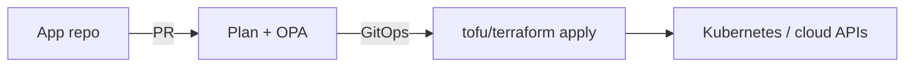

The required lesson introduces declarative IaC, Terraform resources/state, and Ansible. This optional note covers the **August 2023 license split** (Terraform BSL vs **OpenTofu** MPL 2.0 under the Linux Foundation), **policy as code** in the plan path, and platform engineering (golden modules) as the application of IaC in 2024–2026.

Writing Infrastructure as Code stops manual ClickOps—but it still lets a rushed developer write `cidr_blocks = ["0.0.0.0/0"]` on port 22 or spin up a $15,000/month GPU cluster in dev! In 2023–2026, two major shifts matured the IaC ecosystem: **OpenTofu** (the Linux Foundation’s open-source, MPL-licensed continuation of Terraform after HashiCorp’s BSL license change) and **Policy as Code (OPA / Conftest / Checkov)**, which automatically blocks insecure or over-budget infrastructure *inside CI before `apply` ever runs*!

This lesson ties together **OpenTofu**, **Policy as Code**, and **Internal Developer Platforms (Platform Engineering)**—showing how modern orgs ship "golden paths" that make the secure, compliant choice the easiest choice.

---

## Key ideas: Open-Source IaC, Automated Guardrails, and Golden Paths

1. **OpenTofu (Open-Source Governance & State Encryption):** Drop-in HCL-compatible open-source engine under the CNCF/Linux Foundation, adding community-driven features like native client-side **state encryption**.
2. **Policy as Code (OPA / Rego):** Evaluates the structured JSON output of `tofu show -json plan.bin` against declarative compliance rules—automatically denying public S3 buckets, unencrypted volumes, or missing cost-center tags at PR time.
3. **Shift-Left Security & FinOps:** Catching a public database rule in a 5-second CI policy check costs $0; catching it after a data breach costs millions.
4. **Platform Engineering (Golden Paths):** Instead of handing 200 app developers raw 500-line Terraform files, platform teams publish curated, pre-audited modules (`module "web_service"`) with observability, TLS, and least-privilege IAM baked in by default.

---

## Learning objectives

- State what changed on 10 August 2023 and why OpenTofu 1.6 (January 2024) exists.
- Add an OPA/Conftest-style policy so `apply` cannot create a public bucket by accident.
- Describe a platform team’s module registry as an internal SOA.

## 1. Two CLIs, one HCL habit

HashiCorp moved Terraform 1.6+ to **Business Source License 1.1** (not OSI-approved). A vendor coalition forked 1.5.x → OpenTF manifesto → **OpenTofu** at the Linux Foundation (joined September 2023; **1.6.0 stable 10 January 2024**). Day-to-day, `tofu` is largely a drop-in for existing HCL and providers. Divergence since then includes features such as native state encryption in OpenTofu. IBM’s acquisition of HashiCorp (2024–2025) is part of the governance story students should be able to name.

**Course stance:** learn the *ideas* (state, plan, providers). In labs, either CLI is fine; in industry, legal review may pick one.

```hcl
# Same mental model as the required Terraform lesson
resource "aws_s3_bucket" "raw" {
  bucket = "iuh-lab-raw-${var.env}"
}
```

## 2. Policy as code: the admission controller for infrastructure

Declarative IaC is not automatically *safe*. Policy engines (Open Policy Agent, Sentinel, Checkov, Terraform/OpenTofu language checks) evaluate the **plan JSON** before apply.

```rego
# Conftest / OPA-shaped rule (illustrative)
package terraform.s3

deny[msg] {
  some rc
  rc := input.resource_changes[_]
  rc.type == "aws_s3_bucket_public_access_block"
  rc.change.after.block_public_acls == false
  msg := sprintf("%s allows public ACLs", [rc.address])
}
```

This is the same *control-vs-data-plane* split as Kubernetes admission: developers declare intent; the platform enforces residency, tags (FinOps), and encryption.

## 3. Platform engineering: IaC as an internal product

By 2024, many orgs stopped handing every team a raw cloud account. A **platform team** publishes:

- Versioned modules (`eks-cluster/v4`, `postgres/v2`).
- A paved path (Backstage + GitOps + OPA).
- SLOs for “time to a new preview environment.”

CNCF’s 2024 survey highlights CI/CD and GitOps growth; IaC is the *definition*, Git is the *transport*, the cluster (Chapter 09) is the *runtime*. Multi-cloud (Chapter 12) shows up as two providers behind one module interface—not two copies of every repo.



<div class="content-box insight-box">
<p><strong>State is still the hard part.</strong> Whether the file is encrypted by OpenTofu or stored in HCP Terraform, the required lesson’s warning stands: two writers, one state, split-brain.</p>
</div>

## Challenges

- Provider/registry mirroring and lockfiles across forks.
- Module version pinning vs. “always latest” security patches.
- Policy packs that reject every student lab by accident.

---

### Worked Concrete Example: Catching a Public S3 Bucket With Policy-as-Code in CI

Suppose a developer submits a PR adding an S3 bucket in OpenTofu. CI runs `tofu plan -out=plan.bin && tofu show -json plan.bin > plan.json` and feeds `plan.json` to an OPA/Rego policy rule:

```text
Policy Rule: deny if resource.type == "aws_s3_bucket_acl" AND resource.values.acl == "public-read"
```

| PR Check Stage | What Runs | Time Taken | Verdict on `acl = "public-read"` |
| :--- | :--- | :--- | :--- |
| 1. `tofu validate` | HCL syntax & schema check | $$1	ext{ s}$$ | Pass (valid syntax!) |
| 2. `tofu plan` | Diffs against cloud state | $$6	ext{ s}$$ | Pass (`+ 1 to add`) |
| 3. **OPA / Checkov Policy Gate** | Evaluates `plan.json` against security rules | $$2	ext{ s}$$ | **BLOCKED! (Public ACL forbidden!)** |

Notice the key insight: `tofu validate` and `tofu plan` both *succeeded* because a public bucket is syntactically legal—**Policy as Code** is the automated security gate that stops it before it ever touches AWS!

### Explanation: Four Principles of Policy-as-Code & Platform Engineering

1. **Separate *advisory warnings* from *hard deny* policies:** Block severe security/cost violations (`0.0.0.0/0` on DB ports, missing encryption), while warning gently on minor style conventions so teams don’t bypass CI.
2. **Test your policies with unit tests too:** OPA Rego policies are real code—keep positive and negative fixture JSONs so a buggy policy doesn’t accidentally block every deploy!
3. **Enable OpenTofu state encryption for sensitive environments:** Encrypting state at rest with KMS/PBKDF2 adds defense-in-depth beyond S3 bucket permissions.
4. **Build paved roads, not ticket queues:** The goal of Platform Engineering is self-service speed *with* automatic guardrails—not making developers wait 5 days for an ops ticket.

**Quick check.** Why is evaluating Policy-as-Code against `tofu plan`’s JSON output (`plan.json`) stronger than only scanning static `.tf` text files with regex? *(Hint: think about variables, `for_each` loops, and module defaults!)*

---

## Video tham khảo

- **xem trước:** [What is OpenTofu Project?](https://www.youtube.com/watch?v=J2JKxY2elSo) — Oleksiy Pototskyy, English. Watch first: what the OpenTofu project is, the fork this lesson studies beside Terraform.
- [OPA Rego Tutorial: Write and Test Policy as Code](https://www.youtube.com/watch?v=x_IfmWXlHbI) — Spacelift, English. Writing and testing a Rego policy, the policy-as-code section.
- [What is a Platform Engineer?](https://www.youtube.com/watch?v=q6vbxk3hq-o) — HashiCorp, an IBM Company, English. HashiCorp on what a platform engineer does, the internal-product section at the end of the lesson.

## Exercises

1. Write a policy: every resource must have `tags.owner` and `tags.cost_center`.
2. In one paragraph, explain a case where BSL vs MPL would matter to a *vendor* building a SaaS around IaC, vs. a student applying a VM.
3. Design a golden module API for “student preview env” (inputs, outputs, max cost).

## References

1. OpenTofu project: [opentofu.org](https://opentofu.org/).
2. HashiCorp BSL announcement (10 August 2023) and OpenTofu 1.6.0 (10 January 2024) release notes.
3. Open Policy Agent: [openpolicyagent.org](https://www.openpolicyagent.org/).
4. CNCF *Cloud Native 2024 Annual Survey* (CI/CD, GitOps): [cncf.io/reports/cncf-annual-survey-2024](https://www.cncf.io/reports/cncf-annual-survey-2024/).
5. Required Terraform lesson — providers, resources, state — still the prerequisite.
