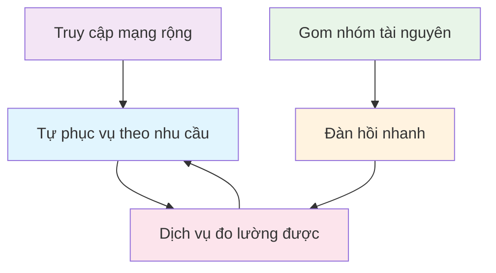

Trước năm 2006, nếu một công ty khởi nghiệp muốn ra mắt trang thương mại điện tử trước dịp Tết, họ phải ký hợp đồng mua máy chủ vật lý trước 3 tháng, thuê chỗ đặt tủ rack tại trung tâm dữ liệu, tự kéo dây mạng và cầu nguyện rằng lượng truy cập đêm giao thừa không vượt quá sức chứa đã mua — nhưng cũng không quá thấp khiến đống phần cứng hàng tỷ đồng nằm đắp chiếu suốt 11 tháng còn lại.

Định nghĩa kinh điển của **NIST (SP 800-145)** ra đời để chấm dứt sự mơ hồ tiếp thị xung quanh từ "đám mây": một nền tảng chỉ thực sự là điện toán đám mây khi hội tụ đủ **5 đặc trưng cốt yếu** — tự phục vụ theo nhu cầu, truy cập mạng rộng, gom nhóm tài nguyên, đàn hồi nhanh và đo lường theo mức dùng thực tế.

---

## Bản đồ kiến thức nền: Năm đặc trưng NIST dưới góc nhìn kỹ thuật hệ thống

### 1. Ảo hóa & API hóa hạ tầng (Self-Service & Broad Network Access)
Thay vì gửi email nhờ quản trị viên cắm cáp, tầng điều khiển đám mây (Control Plane) phơi bày toàn bộ phần cứng dưới dạng **API chuẩn hóa** (REST/CLI/Terraform). Hypervisor và SDN (mạng định nghĩa bằng phần mềm) cắt máy chủ vật lý thành các lát ảo độc lập chỉ trong vài giây.
- **Câu hỏi lớn:** Làm sao một lệnh API duy nhất tạo ra được cả máy ảo, ổ đĩa và đường mạng riêng trong 30 giây?
- **Ứng dụng thực tế:** Infrastructure as Code (Terraform), cổng tự phục vụ nội bộ (IDP).

### 2. Đa thuê bao & Ghép kênh thống kê (Resource Pooling & Rapid Elasticity)
Bí mật kinh tế của đám mây nằm ở **statistical multiplexing (ghép kênh thống kê)**: hiếm khi toàn bộ 1.000 khách hàng cùng đạt đỉnh tải vào đúng cùng một giây. Nhà cung cấp gom hàng trăm nghìn lõi CPU vào bể tài nguyên chung và điều chuyển tức thời cho ai đang tăng đột biến.
- **Câu hỏi lớn:** Làm sao đảm bảo cô lập an toàn giữa các khách hàng dùng chung một máy vật lý (tránh hiệu ứng *noisy neighbor*)?
- **Ứng dụng thực tế:** Auto Scaling Group, bể GPU dùng chung, Kubernetes Cluster Autoscaler.

### 3. Đo lường tinh vi & Kinh tế đám mây (Measured Service)
Hệ thống đo đạc (metering) ghi nhận từng giây vCPU, từng GB lưu trữ và từng triệu yêu cầu API. Nhờ đó chi phí chuyển từ **CapEx** (đầu tư cố định khổng lồ ban đầu) sang **OpEx** (chi phí biến đổi tỷ lệ thuận với doanh thu).
- **Câu hỏi lớn:** Khi nào trả theo giây rẻ hơn mua máy chủ cố định, và khi nào cần mua gói cam kết (Reserved/Savings Plans)?
- **Ứng dụng thực tế:** FinOps, phân bổ chi phí theo từng đội sản phẩm (showback/chargeback).

---

Viện Tiêu chuẩn và Công nghệ Quốc gia Hoa Kỳ (NIST) xác định năm đặc trưng cốt yếu giúp phân biệt điện toán đám mây với các mô hình tính toán truyền thống. Nắm vững năm đặc trưng này — tự phục vụ theo nhu cầu (on-demand self-service), truy cập mạng rộng (broad network access), gom nhóm tài nguyên (resource pooling), đàn hồi nhanh (rapid elasticity) và dịch vụ đo lường được (measured service) — là cơ sở để nhận diện đúng một dịch vụ đám mây và đưa ra quyết định áp dụng phù hợp.

## 1. Tự phục vụ theo nhu cầu (On-Demand Self-Service)

Tự phục vụ theo nhu cầu cho phép người dùng chủ động cấp phát năng lực tính toán — như thời gian máy chủ hay dung lượng lưu trữ mạng — một cách tự động mà không cần tương tác trực tiếp với nhân sự của nhà cung cấp. Trong môi trường CNTT truyền thống, việc yêu cầu một máy chủ mới thường phải qua nhiều bước thủ công: gửi phiếu yêu cầu, chờ phê duyệt ngân sách rồi xếp lịch cấu hình. Mô hình đám mây gần như loại bỏ độ trễ quy trình này.

Nhờ đó, người dùng có thể tiếp cận tài nguyên gần như ngay lập tức. Dù lập trình viên cần một môi trường thử nghiệm trong vài giờ hay nhà khoa học dữ liệu cần cụm máy tính hiệu năng cao cho mô phỏng, họ đều có thể khởi tạo tài nguyên trong vài phút — thậm chí vài giây — thông qua bảng điều khiển web hoặc API lập trình. Mức độ tự động hóa này chuyển trọng tâm từ mua sắm phần cứng sang phát triển sản phẩm, đồng thời trao cho người dùng quyền kiểm soát trực tiếp vòng đời tài nguyên.

### Tác động kinh doanh

Rút ngắn thời gian cấp phát tài nguyên từ vài tuần xuống vài phút giúp giảm đáng kể thời gian đưa sản phẩm ra thị trường (time-to-market). Doanh nghiệp có thể thử nghiệm ý tưởng mới, phát hiện sớm sai sót và điều chỉnh nhanh mà không bị ràng buộc bởi thời gian chờ đợi hay chi phí phần cứng đầu tư cố định.

## 2. Truy cập mạng rộng (Broad Network Access)

Các dịch vụ đám mây luôn sẵn sàng qua mạng và được truy cập thông qua các giao thức chuẩn, cho phép sử dụng trên nhiều loại thiết bị khách khác nhau. Điều này có nghĩa là dịch vụ không bị gắn chặt vào một địa điểm vật lý hay phần cứng chuyên dụng; người dùng có thể truy cập từ bất cứ đâu có kết nối Internet, bằng điện thoại, máy tính bảng, máy tính xách tay hay máy trạm doanh nghiệp.

Nhờ dựa trên các giao thức Internet phổ biến như HTTP, HTTPS và REST API, điện toán đám mây bảo đảm khả năng truy cập thống nhất. Đặc trưng này tạo điều kiện thuận lợi cho mô hình làm việc phân tán, đồng thời giúp lập trình viên xây dựng ứng dụng phục vụ người dùng trên nhiều thiết bị và hệ điều hành khác nhau.

### Hệ quả thực tiễn

Khả năng truy cập qua giao thức chuẩn giúp thống nhất luồng dữ liệu giữa nhiều nền tảng: người dùng có thể tải tệp lên qua trình duyệt web, ứng dụng di động đọc lại tệp đó, còn máy chủ backend xử lý qua API — tất cả cùng tương tác với một dịch vụ lưu trữ đám mây duy nhất.

## 3. Gom nhóm tài nguyên (Resource Pooling)

Nhà cung cấp gom các tài nguyên tính toán thành một kho chung để phục vụ nhiều khách hàng theo mô hình đa thuê bao (multi-tenant), trong đó tài nguyên vật lý và tài nguyên ảo được phân bổ, thu hồi và tái phân bổ động theo nhu cầu. Cách vận hành này tương tự lưới điện công cộng: người tiêu dùng không cần tự vận hành máy phát riêng mà lấy điện từ nguồn cung dùng chung.

### Đa thuê bao và trừu tượng hóa vị trí

Ở tầng vật lý, nhiều khách hàng (tenant) có thể dùng chung máy chủ, hệ thống lưu trữ hoặc thiết bị chuyển mạch mạng, nhưng vẫn được cô lập về mặt logic và bảo mật. Mô hình đa thuê bao giúp nhà cung cấp đạt lợi thế kinh tế theo quy mô, tối ưu hóa hiệu suất sử dụng phần cứng và điện năng. Về phía người dùng, vị trí vật lý cụ thể của tài nguyên thường được trừu tượng hóa: bạn có thể chọn một khu vực địa lý (ví dụ "US East" hoặc "Europe") để tối ưu độ trễ hay đáp ứng quy định pháp lý, nhưng không cần biết chính xác tủ rack hay máy chủ vật lý nào đang chạy ứng dụng.

## 4. Đàn hồi nhanh (Rapid Elasticity)

Năng lực tính toán có thể được cấp phát mở rộng hoặc thu hồi linh hoạt — thường là tự động — để thích ứng kịp thời với sự thay đổi của nhu cầu. Từ góc nhìn của người dùng, nguồn tài nguyên sẵn có gần như đáp ứng được mọi mức quy mô cần thiết tại thời điểm phát sinh.

Tính đàn hồi cho phép hệ thống thích nghi với biến động tải theo thời gian thực. Chẳng hạn, một trang thương mại điện tử có thể tự động mở rộng ngang (`scale out`, bổ sung máy chủ web) trong đợt khuyến mãi lớn như Black Friday để xử lý lượng truy cập tăng vọt; khi sự kiện kết thúc, hệ thống tự động thu hẹp (`scale in`, giải phóng máy chủ dư thừa). Cơ chế này vừa giữ hiệu năng ổn định vào giờ cao điểm, vừa tránh lãng phí chi phí đầu tư sẵn cho kịch bản tải cực đại.

## 5. Dịch vụ đo lường được (Measured Service)

Hệ thống đám mây tự động kiểm soát và tối ưu hóa việc sử dụng tài nguyên dựa trên cơ chế đo lường ở mức trừu tượng phù hợp với từng loại dịch vụ. Tương tự hóa đơn điện hoặc nước, điện toán đám mây áp dụng mô hình trả phí theo mức tiêu thụ thực tế (pay-as-you-go).

Mức sử dụng — từ số lượng máy ảo, dung lượng lưu trữ, lưu lượng mạng đến số tài khoản hoạt động — đều được giám sát và báo cáo liên tục. Tính minh bạch này có lợi cho cả hai phía: nhà cung cấp quản lý công suất hạ tầng hiệu quả hơn, còn khách hàng theo dõi được chi tiết từng khoản chi phí, áp dụng cơ chế phân bổ ngân sách nội bộ (chargeback) và phát hiện sớm các tài nguyên nhàn rỗi để tắt bỏ.

### Các mô hình định giá

Cơ chế đo lường hỗ trợ nhiều hình thức thanh toán linh hoạt: giá theo nhu cầu (on-demand) cho khối lượng công việc ngắn hạn; gói cam kết đặt trước (reserved instances) giúp giảm chi phí đáng kể cho tải ổn định dài hạn; và giá spot tận dụng tài nguyên nhàn rỗi với chi phí thấp cho các tác vụ có thể chịu gián đoạn.

## Tính liên kết giữa năm đặc trưng

Năm đặc trưng trên không tồn tại tách rời mà bổ trợ chặt chẽ cho nhau:

Chẳng hạn, **gom nhóm tài nguyên** tạo ra phần công suất dự trữ quy mô lớn để **đàn hồi nhanh** trở nên khả thi. **Truy cập mạng rộng** bảo đảm cổng **tự phục vụ theo nhu cầu** có thể hoạt động từ mọi nơi. Cuối cùng, **dịch vụ đo lường được** gắn kết toàn bộ hệ thống bằng cách theo dõi và tính phí chính xác mọi tài nguyên được cấp phát động.

## Danh mục kiểm tra

Để đánh giá một dịch vụ có thực sự đáp ứng tiêu chuẩn điện toán đám mây hay không, có thể đối chiếu năm câu hỏi sau:

- **Tự phục vụ:** Người dùng có thể tự cấp phát tài nguyên ngay lập tức mà không cần can thiệp thủ công?
- **Truy cập mạng:** Dịch vụ có thể truy cập từ nhiều thiết bị và vị trí thông qua các giao thức mạng chuẩn?
- **Gom nhóm tài nguyên:** Tài nguyên có được chia sẻ hiệu quả giữa nhiều người dùng với sự cô lập hợp lý?
- **Đàn hồi:** Hệ thống có thể tăng hoặc giảm quy mô tự động theo biến động tải?
- **Dịch vụ đo lường được:** Mức sử dụng có được giám sát, đo đạc và tính phí minh bạch theo thực tế tiêu thụ?

## Kết luận

Hiểu rõ năm đặc trưng cốt yếu của NIST là nền tảng để đánh giá các dịch vụ đám mây một cách khách quan. Mỗi đặc trưng đóng góp trực tiếp vào các giá trị cốt lõi của điện toán đám mây: tính linh hoạt, hiệu quả chi phí và khả năng mở rộng.

Bài học tiếp theo sẽ phân tích cách các đặc trưng này thể hiện trong ba mô hình dịch vụ phổ biến: Hạ tầng như một dịch vụ (IaaS), Nền tảng như một dịch vụ (PaaS) và Phần mềm như một dịch vụ (SaaS).

---

## Ví dụ cầm tay chỉ việc & Khung giải thích

### Ví dụ cầm tay chỉ việc 1: So sánh chi phí tải đỉnh mùa sale — Máy chủ cố định vs. Đàn hồi nhanh

Giả sử một sàn thương mại điện tử cần **10 máy chủ** suốt 28 ngày thường và **100 máy chủ** trong 2 ngày siêu sale (tổng 30 ngày = 720 giờ), đơn giá đám mây là **$$0.10/	ext{giờ/máy}$$**:

| Phương án | Cách cấp phát | Tổng số giờ-máy trong tháng | Chi phí tháng |
|---|---|---|---|
| **Cố định theo đỉnh (Không đàn hồi)** | Luôn giữ 100 máy × 720 giờ | $$72{,}000$$ giờ-máy | **$$7{,}200$$ USD** |
| **Đàn hồi nhanh (Auto-scaling)** | 10 máy × 672 giờ + 100 máy × 48 giờ | $$6{,}720 + 4{,}800 = 11{,}520$$ giờ-máy | **$$1{,}152$$ USD** |

**Kết quả:** Đặc trưng **Rapid Elasticity + Measured Service** cắt giảm ngay **84% hóa đơn hạ tầng** (tiết kiệm $$6{,}048$$ USD/tháng) mà vẫn giữ nguyên năng lực chịu tải 100 máy trong 48 giờ cao điểm!

### Ví dụ cầm tay chỉ việc 2: Kiểm tra bài test NIST — VPS truyền thống có phải Cloud thật không?

Đặt một dịch vụ thuê VPS truyền thống (phải mở ticket chờ nhân viên kích hoạt trong 24 giờ, thanh toán gói cố định theo tháng, muốn nâng RAM phải tắt máy chuyển sang máy khác) lên bàn cân 5 tiêu chí NIST:
1. *On-Demand Self-Service:* **Không đạt** (phải chờ con người duyệt ticket).
2. *Broad Network Access:* Đạt (SSH/HTTPS qua Internet).
3. *Resource Pooling:* Đạt một phần (chia sẻ máy chủ vật lý).
4. *Rapid Elasticity:* **Không đạt** (không thể tự co giãn ngang theo tải trong vài phút).
5. *Measured Service:* **Không đạt** (tính phí phẳng cả tháng dù chỉ dùng 2 giờ).
→ Kết luận: Đó chỉ là **hosting ảo hóa**, chưa phải điện toán đám mây theo chuẩn NIST!

### Khung giải thích: Vì sao 5 đặc trưng NIST không thể tách rời nhau (nên đọc chậm)

#### Bước 1: Không có tự động hóa (Self-Service) thì không thể có Đàn hồi nhanh
Nếu mỗi lần tăng từ 10 lên 50 máy cần con người bấm duyệt, hệ thống sẽ sập trước khi máy thứ 11 kịp khởi động. API tự phục vụ chính là nền móng để bộ Auto-Scaler tự động gọi lệnh mở rộng trong vài chục giây.

#### Bước 2: Không có Gom nhóm tài nguyên (Pooling) thì Đàn hồi nhanh trở nên vô nghĩa
Muốn khách hàng cảm thấy tài nguyên "vô hạn", nhà cung cấp buộc phải duy trì một bể dự phòng khổng lồ dùng chung cho hàng triệu khách hàng khác nhau.

#### Bước 3: Không có Đo lường (Measured Service) thì Đàn hồi nhanh sẽ đốt sạch ngân sách
Nếu một lỗi vòng lặp vô hạn kích hoạt Auto-Scaler bung ra 500 máy chủ mà không có cảnh báo đo lường theo phút, doanh nghiệp sẽ nhận hóa đơn hàng chục nghìn USD chỉ sau một đêm!

#### Bước 4: Kiểm tra hệ thống thực tế bằng câu hỏi "cơ chế nào thực thi đặc trưng này?"
Khi đánh giá bất kỳ dịch vụ đám mây nào, đừng đọc tờ rơi quảng cáo — hãy kiểm tra xem nó có API tự động hóa, auto-scaling theo metric và bảng giá chi tiết theo giây/yêu cầu hay không.

## Video tham khảo

- **Xem trước:** [The 5 Essential Characteristics of Cloud Computing - NIST Framework](https://www.youtube.com/watch?v=W7miGLWRFgc) — Hamza (tiếng Anh). Trình bày khung năm đặc trưng cốt yếu của NIST khớp với danh mục kiểm tra trong bài.
- [The 5 Key Characteristics of Cloud Computing](https://www.youtube.com/watch?v=JYq1AQkMdhE) — The Cloud Mentor (tiếng Anh). Lượt giải thích bổ sung giúp phân biệt rõ tự phục vụ, gom nhóm tài nguyên, đàn hồi và đo lường.
- [What is Cloud Computing? \| Amazon Web Services](https://www.youtube.com/watch?v=mxT233EdY5c) — Amazon Web Services (tiếng Anh). Minh họa cách AWS triển khai cơ chế cấp phát theo nhu cầu và trả phí theo mức sử dụng.
