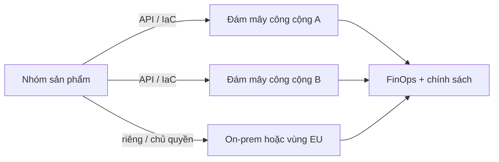

Bài tùy chọn này **không** thay thế các đặc trưng NIST, mô hình dịch vụ hay mô hình triển khai trong phần bắt buộc, mà minh họa cách các nguyên lý đó vận hành trong các hệ thống thực tế giai đoạn 2022–2026: kiến trúc đa đám mây, quản trị chi phí FinOps dưới góc nhìn *measured service*, ràng buộc về chủ quyền dữ liệu và việc phục vụ mô hình AI như một khối lượng công việc đám mây chủ lực.

## Mục tiêu học tập

- Liên hệ đặc trưng *đàn hồi nhanh (rapid elasticity)* và *dịch vụ đo lường được (measured service)* của NIST với thực hành FinOps và lập kế hoạch công suất cho hệ thống AI.
- Phân biệt *đa đám mây tự phát* với *đa đám mây có chủ đích* (phục vụ yêu cầu lưu trữ dữ liệu theo vùng, chọn dịch vụ tối ưu cho từng bài toán hoặc duy trì phương án chuyển đổi).
- Phác thảo kiến trúc phục vụ mô hình AI tuân theo ranh giới IaaS/PaaS/SaaS.

## 1. Đa đám mây là thực tế vận hành, không chỉ là khẩu hiệu

Theo báo cáo *2025 State of the Cloud* của Flexera (ấn bản thứ 14, khảo sát hơn 750 chuyên gia), **70%** tổ chức đang vận hành mô hình lai (kết hợp ít nhất một đám mây công cộng và một đám mây riêng) và sử dụng trung bình khoảng **2,4 nhà cung cấp đám mây công cộng**. Quản lý chi tiêu đám mây là thách thức hàng đầu với **84%** người tham gia khảo sát; tỷ lệ tổ chức có đội ngũ FinOps phụ trách một phần hoặc toàn bộ tối ưu chi phí tăng từ **51% lên 59%**. Dự báo chi tiêu tiếp tục tăng (~28%) song hành với mức lãng phí ước tính ở tầng IaaS/PaaS (~27%), trong khi tỷ lệ đưa khối lượng công việc quay lại tại chỗ vẫn ở mức khiêm tốn (~21%), khiến quy mô sử dụng đám mây ròng tiếp tục mở rộng.

Thực tế này cho thấy mô hình NIST đang chịu áp lực vận hành ở quy mô lớn: **gom nhóm tài nguyên** xuyên nhiều nhà cung cấp, **tự phục vụ theo nhu cầu** qua API và **dịch vụ đo lường được** đã trở thành chỉ số tài chính trọng yếu thay vì khoản mục phụ.



**Câu hỏi thiết kế:** Nếu dịch vụ của bạn chỉ chạy được trên các API độc quyền của một nhà cung cấp duy nhất, bạn mới chỉ có *mô hình triển khai* (đám mây công cộng) chứ chưa có kiến trúc *di động (portable)*. Tính di động phải là một yêu cầu thiết kế có chủ đích, không tự nhiên có sẵn.

## 2. FinOps là *measured service* có vòng phản hồi

Đặc trưng *measured service* của NIST dừng ở bước đo lường tiêu thụ. FinOps mở rộng thêm các bước phân bổ chi phí, dự báo và tính toán chi phí đơn vị (unit economics — chi phí trên mỗi đơn hàng, mỗi lượt suy luận AI hoặc mỗi tenant). Một vòng phản hồi FinOps tối thiểu gồm ba bước:

1. **Gắn thẻ (tagging) và phân bổ** mọi tài nguyên phát sinh chi phí theo nhóm, môi trường và sản phẩm.
2. **Đặt chi phí đơn vị** song song với chỉ tiêu dịch vụ SLO (độ trễ p99, tỷ lệ lỗi), không chỉ nhìn vào tổng hóa đơn.
3. **Điều chỉnh kỹ thuật:** chọn lại kích cỡ tài nguyên (right-sizing), kết hợp gói cam kết (reserved) và spot, bật cơ chế `scale-to-zero`, hoặc chuyển khối lượng công việc về tại chỗ khi bài toán kinh tế đảo chiều.

Ví dụ đoạn mã Python kiểm tra chi phí đơn vị từ dữ liệu hóa đơn:

```python
def unit_cost(invoice_usd: float, successful_inferences: int) -> float:
    if successful_inferences <= 0:
        raise ValueError("không có việc thành công để phân bổ chi phí")
    return invoice_usd / successful_inferences

gpu_unit = unit_cost(18_400.0, successful_inferences=2_100_000)
api_unit = unit_cost(9_250.0, successful_inferences=2_100_000)
print(f"GPU ${gpu_unit:.4f}  vs  API ${api_unit:.4f} mỗi lần suy luận")
```

Bản thân con số chưa phải là chiến lược; chiến lược nằm ở việc làm cho **chi phí của tính đàn hồi trở nên minh bạch**, tránh biến đám mây thành khoản chi không kiểm soát.

## 3. Phục vụ AI như một mẫu kiến trúc đám mây

AI tạo sinh không tạo ra đặc trưng NIST mới, mà đặt áp lực cao lên tất cả các đặc trưng hiện có. Một ngăn xếp phục vụ mô hình AI điển hình giai đoạn 2024–2026 gồm các lớp sau:

| Lớp | Vai trò | Ánh xạ đám mây |
| --- | --- | --- |
| Client / BFF | Xác thực, hạn mức, chính sách prompt | SaaS hoặc PaaS tự xây |
| Bộ định tuyến suy luận | Quản lý phiên bản mô hình, A/B testing, cache | PaaS / service mesh |
| Engine (ví dụ vLLM) | Giải mã (decode) trên GPU theo lô | IaaS + máy chủ GPU |
| Điều phối (KServe, Ray Serve) | Mở rộng quy mô, triển khai canary, giao thức | Kubernetes / PaaS |

KServe (dự án CNCF ở giai đoạn incubating từ cuối năm 2025) xem `InferenceService` như một tài nguyên Kubernetes có hỗ trợ `scale-to-zero` và chia lưu lượng canary. Ray Serve cho phép ghép nối các đồ thị xử lý Python (truy xuất → xếp hạng lại → sinh văn bản) trên KubeRay. Cả hai thường bọc **vLLM** để cung cấp giao diện HTTP tương thích chuẩn OpenAI. Dưới góc nhìn SOA, *mô hình AI* lúc này được vận hành như một dịch vụ có phiên bản và cam kết SLA rõ ràng, không còn là tệp mã thử nghiệm trong notebook.

<div class="content-box warning-box">
<p><strong>Cold start và chi phí GPU.</strong> Cơ chế <code>scale-to-zero</code> hấp dẫn về mặt tiết kiệm chi phí trên lý thuyết, nhưng lại gây độ trễ đuôi (tail latency) rất lớn đối với LLM khi phải nạp lại trọng số mô hình. Các hệ thống sản xuất thường đặt <code>minReplicas: 1</code> và mở rộng đàn hồi theo số lượng bản sao (replica) thay vì giảm về 0.</p>
</div>

## 4. Chủ quyền dữ liệu và tuân thủ định hình lại mô hình triển khai

Bốn mô hình public, private, hybrid và community vẫn giữ nguyên giá trị nền tảng, nhưng câu hỏi *dữ liệu thực sự được lưu ở đâu* ngày càng chi phối thiết kế kiến trúc. Các quy định bảo vệ dữ liệu tại châu Âu và điều khoản hợp đồng doanh nghiệp thúc đẩy sự phát triển của **vùng đám mây chủ quyền (sovereign region)**, khóa mã hóa do khách hàng tự quản lý và thiết kế giữ dữ liệu cố định trong một VPC. Mô hình hybrid vì thế không còn chỉ gắn với hệ thống cũ dưới phòng máy, mà thường đóng vai trò vùng *tuân thủ pháp lý* đặt cạnh hạ tầng đám mây công cộng phổ thông.

## Thách thức

- **Đa đám mây tự phát:** Tổ chức sử dụng hai nhà cung cấp chỉ vì các nhóm tự chọn theo thói quen, thiếu sự thống nhất về quản lý định danh, mạng và luồng dữ liệu.
- **Khó dự báo chi phí AI:** Chi phí theo token và giờ thuê GPU biến động mạnh và khó ước lượng hơn so với giờ chạy máy ảo truyền thống.
- **Lệch mục tiêu giữa các nhóm:** Đội FinOps, đội nền tảng và đội vận hành ML thường theo đuổi các chỉ tiêu SLO và ưu tiên khác nhau.

## Video tham khảo

- **Xem trước:** [What is Multicloud? How Do You Manage It?](https://www.youtube.com/watch?v=AjtdZ3gFRjU) — IBM Technology (tiếng Anh). Giới thiệu bài toán vận hành đa đám mây, phù hợp với phần mở đầu của bài.
- [What is FinOps? The Operating Model & Cultural Practice to Maximize the Value of Technology](https://www.youtube.com/watch?v=Y-c_xw9bHFw) — FinOps Foundation (tiếng Anh). Trình bày mô hình FinOps xoay quanh việc đo lường và tối ưu chi tiêu đám mây.
- [Introducing Amazon Bedrock \| Amazon Web Services](https://www.youtube.com/watch?v=_vdK5PgcNvc) — Amazon Web Services (tiếng Anh). Giới thiệu ngắn gọn một dịch vụ AI tạo sinh được quản lý, minh họa cho mẫu kiến trúc phục vụ AI trong bài.

## Bài tập

1. Lấy một ví dụ từ phần bắt buộc (chẳng hạn kịch bản tăng tải đột biến trong thương mại điện tử) và bổ sung nhà cung cấp đám mây thứ hai *chỉ* cho lưu trữ đối tượng (object storage). Liệt kê các chi phí phát sinh về quản lý định danh, độ trễ và phí truyền dữ liệu ra ngoài (egress).
2. Dựa vào bảng giá công khai, ước lượng chi phí hằng tháng cho 10 triệu lượt gọi LLM ngắn trên API được quản lý so với thuê một GPU theo gói đặt trước (reserved), kèm nêu rõ các giả định tính toán.
3. Soạn một chính sách lưu trữ dữ liệu theo vùng (data residency) gồm sáu dòng, quy định rõ loại dữ liệu nào (log, embedding, prompt) được phép hoặc không được phép rời khỏi lãnh thổ Việt Nam / EU.

## Tài liệu tham khảo

1. Flexera, *2025 State of the Cloud Report* (tháng 3/2025). [Tóm tắt báo chí](https://www.flexera.com/about-us/press-center/new-flexera-report-finds-84-percent-of-organizations-struggle-to-manage-cloud-spend); [xu hướng](https://www.flexera.com/blog/finops/the-latest-cloud-computing-trends-flexera-2025-state-of-the-cloud-report/).
2. Flexera, bản PDF đầy đủ: [Flexera-State-of-the-Cloud-Report-2025.pdf](https://resources.flexera.com/web/pdf/Flexera-State-of-the-Cloud-Report-2025.pdf).
3. CNCF / Linux Foundation Research, *Cloud Native 2024 Annual Survey* (1/4/2025): [trang báo cáo](https://www.cncf.io/reports/cncf-annual-survey-2024/).
4. NIST SP 800-145 — chuẩn định nghĩa nền tảng của các bài bắt buộc mà các ứng dụng hiện đại vẫn dựa trên.
5. Tài liệu vLLM và KServe `InferenceService` (CNCF; công bố giai đoạn incubating tháng 11/2025).
