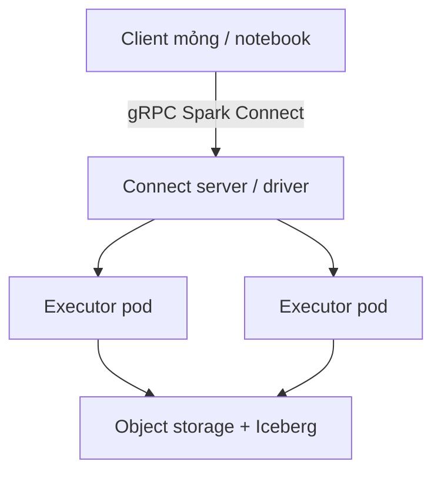

Trong suốt hơn một thập kỷ, muốn chạy một dòng mã PySpark từ laptop hay từ một microservice nhỏ, lập trình viên phải cài cả Java (JVM), tải bộ nhị phân Spark nặng hàng trăm megabyte và giữ cho tiến trình Driver sống bền bỉ ngay trong máy gọi. Chỉ cần laptop gập nắp hoặc một thư viện Python xung đột với JVM là cả phiên phân tích sập theo. **Spark Connect** ra đời để cắt đứt sợi dây buộc cứng đó: biến Spark từ một "thư viện nhúng cồng kềnh" thành một **dịch vụ từ xa đúng nghĩa SOA**, nơi phía client chỉ gửi kế hoạch truy vấn gọn nhẹ qua gRPC.

Phần lý thuyết bắt buộc trình bày kiến trúc driver, executor, RDD và trình quản lý cụm (bao gồm Kubernetes). Bài tùy chọn này tập trung vào xu hướng **coi Spark như một dịch vụ từ xa**: kiến trúc Spark Connect (từ Spark 3.4) cùng mô hình client/server trên **Spark 4.0.0** (phát hành ngày 23/5/2025), đồng thời giải thích vì sao nhiều tổ chức giai đoạn 2022–2026 chọn chạy Spark trên Kubernetes thay vì duy trì cụm YARN thường trực.

> Lý thuyết bắt buộc hiện ở bản tiếng Anh. Đây là bài ứng dụng tùy chọn bằng tiếng Việt.

Trước đây, mỗi khi một kỹ sư dữ liệu muốn gọi Apache Spark từ laptop hoặc từ một microservice nhẹ, ứng dụng khách buộc phải nhúng nguyên một máy ảo **JVM nặng hàng trăm megabyte** cùng đúng phiên bản PySpark khớp từng số lẻ với cụm máy chủ. Chỉ một lỗi tràn bộ nhớ (OOM) trên notebook của thực tập sinh cũng có thể làm sập cả **Spark Driver** đang phục vụ chung cho nhiều người!

**Spark Connect** (và bước tiến **Spark 4.0**) lật ngược kiến trúc nguyên khối đó thành mô hình **client–server tách rời chuẩn cloud-native**: máy khách chỉ gửi một kế hoạch truy vấn logic gọn nhẹ qua **gRPC** và nhận kết quả dạng cột **Apache Arrow**, để toàn bộ phần nặng nhọc chạy tách biệt và an toàn trên cụm Kubernetes.

---

## Bản đồ kiến thức nền: Bốn trụ cột của Kiến trúc Dữ liệu Lớn Cloud-Native

Để hiểu vì sao Spark Connect thay đổi hoàn toàn cách tích hợp Big Data vào kiến trúc hướng dịch vụ (SOA), hãy nắm bốn trụ cột sau:

1. **Tách rời Client – Driver (Decoupled Architecture):** Thay vì chạy trực tiếp bên trong tiến trình JVM Driver, client mỏng (`pyspark-client`, Go, Rust) giao tiếp qua giao thức **gRPC + Protobuf**, cho phép nâng cấp cụm Spark độc lập mà không bắt mọi microservice biên dịch lại.
2. **Kế hoạch logic bất biến (Unresolved Logical Plan):** Client không gửi bytecode hay dữ liệu thô; nó gửi một đồ thị toán tử logic (`Filter -> GroupBy -> Agg`) để bộ tối ưu **Catalyst** trên máy chủ tự đẩy điều kiện lọc xuống tầng lưu trữ (predicate pushdown).
3. **Truyền tải cột không sao chép (Apache Arrow):** Kết quả trả về client được đóng gói theo định dạng cột Arrow, giúp chuyển thẳng sang Pandas/Polars mà không tốn chi phí tuần tự hóa (serialization) từng dòng chậm chạp.
4. **Thực thi đàn hồi trên Kubernetes & Object Storage (Lakehouse):** Tách lưu trữ (S3/GCS dạng Parquet/Iceberg/Delta) khỏi tính toán (pod executor tự co giãn theo tải), đưa Big Data hòa nhập trọn vẹn vào hạ tầng cloud-native.

---

## Bản đồ kiến thức nền: Bốn trụ cột của Spark thế hệ cloud-native

1. **Tách rời Client và Driver (Spark Connect trên gRPC)**:
   Thay vì nhúng JVM vào ứng dụng người dùng, client mỏng (~1,5 MB với `pyspark-client`) chỉ biên dịch các lệnh DataFrame thành **Unresolved Logical Plan** rồi gửi qua gRPC tới Spark Connect Server trên cụm.
2. **Bộ tối ưu Catalyst & Engine Tungsten (Chạy hoàn toàn ở phía Server)**:
   Mọi bước phân tích lược đồ, tối ưu hóa truy vấn (predicate pushdown, join reordering) và sinh mã bytecode hiệu năng cao vẫn diễn ra tập trung trên máy chủ Spark, giúp mọi ngôn ngữ (Python, Go, Rust, Swift) hưởng chung một động cơ tối ưu.
3. **Chuyển dịch từ RDD mức thấp sang DataFrame/SQL khai báo**:
   API RDD đời cũ gửi hàm lambda tuần tự hóa trực tiếp (khó tối ưu và gắn chặt JVM). Spark Connect chỉ mở đường cho DataFrame và SQL khai báo, đổi lại tính di động đa ngôn ngữ và khả năng nâng cấp cụm độc lập với client.
4. **Kubernetes làm trình quản lý cụm thống nhất**:
   Thay vì vận hành cụm YARN riêng cho dữ liệu và Kubernetes riêng cho microservice, các đội hạ tầng triển khai Driver và Executor ngay dưới dạng Pod Kubernetes, dùng chung hệ thống quan sát (OpenTelemetry/Prometheus) và cơ chế tự động co giãn.

## Mục tiêu học tập

- Giải thích cơ chế của Spark Connect trong việc tách rời *tiến trình người dùng* và *session trên cụm* thông qua gRPC.
- Liệt kê các cải tiến đáng chú ý của Spark 4.0 cho client Connect (gói Python client gọn nhẹ, cấu hình `spark.api.mode`, hỗ trợ ML trên Connect).
- Xác định trường hợp mã nguồn dựa trên API RDD cũ cản trở quá trình chuyển sang Spark Connect.

## 1. Hạn chế của mô hình driver gắn chặt tiến trình người dùng

Trong kiến trúc Spark cổ điển, tiến trình JVM/Python của người dùng gắn trực tiếp vào luồng điều khiển cụm. Điều này gây ra nhiều bất tiện trong các hệ thống hiện đại:

- Các ứng dụng dữ liệu đa thuê bao và IDE không phù hợp để đóng gói trọn bộ PySpark nặng khoảng 200 MB.
- Môi trường notebook từ xa dễ bị ngắt phiên làm việc nếu tiến trình driver bị thu hồi tài nguyên đột ngột (preempt).
- Khó xây dựng client cho các ngôn ngữ không dựa trên nền tảng JVM.

Spark Connect giải quyết vấn đề này bằng cách chỉ gửi **kế hoạch truy vấn logic chưa phân giải (unresolved logical plan)** qua gRPC. Phía máy chủ đảm nhận bộ tối ưu Catalyst và engine thực thi Tungsten, còn phía client chỉ là một lớp stub gọn nhẹ. Theo tài liệu chính thức, các API mức thấp như RDD và `SparkContext` **không** được hỗ trợ qua Spark Connect — chỉ giao diện DataFrame và SQL hoạt động trên đường này.

```python
from pyspark.sql import SparkSession

spark = (
    SparkSession.builder
    .config("spark.api.mode", "connect")
    .remote("sc://spark-connect-server:15002")
    .getOrCreate()
)

df = spark.read.parquet("s3a://lab/events/")
df.groupBy("country").count().show()
```

Theo ghi chú phát hành Spark 4.0, các điểm đáng chú ý gồm: gói **`pyspark-client` chỉ khoảng 1,5 MB**, bản phân phối bật sẵn Connect, tương thích API client Java, hỗ trợ thư viện học máy (ML) trên Connect và mở rộng client cho nhiều ngôn ngữ mới (bao gồm Swift). Databricks Runtime 17.0 cũng tích hợp sẵn Spark 4.0 cho môi trường thực hành quản lý.

## 2. Vận hành Spark trên Kubernetes

Giai đoạn 2022–2026, các nhóm hạ tầng thường triển khai Spark dưới dạng **Pod** trên Kubernetes với các đặc điểm:

- Cô lập bộ driver và executor riêng cho từng tác vụ (hoặc chạy một Deployment Spark Connect sống dài hạn).
- Sử dụng `nodeSelector` để phân bổ máy ảo spot hoặc on-demand, cũng như nút có GPU cho pandas UDF hoặc PyTorch.
- Dùng chung hệ thống quan sát (OpenTelemetry, Prometheus) với các microservice khác trong cụm.

Kiến trúc lõi (driver/executor) vẫn giữ nguyên như phần lý thuyết, chỉ thay đổi **trình quản lý cụm (cluster manager)**. Tuy nhiên, quản lý dịch vụ shuffle và cấp phát tài nguyên động trên Kubernetes đòi hỏi cấu hình bổ sung ở tầng nền tảng ứng dụng thay vì chỉ thuộc trách nhiệm của quản trị viên Hadoop.



## 3. Ba mẫu kiến trúc ứng dụng tiêu biểu

1. **Phân tích tương tác:** Nhiều người dùng kết nối tới một điểm cuối Spark Connect chung, áp dụng phân quyền dữ liệu ở mức hàng ngay trên phía máy chủ.
2. **Tính toán đặc trưng định kỳ:** Kubernetes `CronJob` hoặc Airflow chỉ cần chứa client gọn nhẹ trong pipeline CI/CD để gửi tác vụ lên cụm.
3. **Spark nhúng trong kiến trúc dịch vụ:** Một microservice viết bằng Go hoặc Python gọi tới Spark để nối (join) tập dữ liệu 2 TB rồi nhận về tập kết quả tổng hợp nhỏ — theo tinh thần SOA, Spark lúc này là một *dịch vụ phụ thuộc*, không bao trùm toàn bộ ứng dụng.

<div class="content-box warning-box">
<p><strong>Lưu ý về bài tập RDD và Spark Connect.</strong> Nếu bài thực hành vẫn yêu cầu dùng <code>sc.parallelize</code> và quản lý phân vùng thủ công, bạn đang làm việc trên Spark Classic. Cách tiếp cận này hữu ích để hiểu cơ chế lineage, nhưng không phản ánh mặc định của các ứng dụng triển khai giai đoạn 2025 trở đi.</p>
</div>

### Khung giải thích (nên đọc chậm): So sánh định lượng ảnh Docker & quy hoạch Pod cho một microservice gọi Spark

Giả sử nhóm bạn xây dựng một dịch vụ FastAPI nhỏ (`reports-api`, chạy **10 bản sao Pod**) thỉnh thoảng cần gọi Spark để tổng hợp báo cáo từ 500 GB dữ liệu Parquet. Hãy đặt hai kiến trúc lên bàn cân bằng con số cụ thể:

| Thông số đóng gói & vận hành | Spark Classic (nhúng PySpark + JVM trong từng Pod) | Spark Connect (dùng `pyspark-client` qua gRPC) |
| :--- | :---: | :---: |
| Dung lượng thêm vào Docker image | OpenJDK (~200 MB) + PySpark (~300 MB) = **+500 MB** | `pyspark-client` + gRPC = **~15 MB** (gọn hơn $$33\times$$) |
| RAM nền tối thiểu cho mỗi Pod API | ~1.500 MB (JVM heap + Python worker) | ~180 MB (chỉ tiến trình Python + kết nối gRPC) |
| **Tổng RAM cho 10 Pod `reports-api`** | $$10 \times 1{,}5\text{ GB} = \mathbf{15\text{ GB RAM}}$$ | $$10 \times 0{,}18\text{ GB} = \mathbf{1{,}8\text{ GB RAM}}$$ |
| Khi nâng cấp Spark 3.5 → Spark 4.0 | Phải build lại và deploy lại toàn bộ 10 Pod API | Chỉ nâng cấp Deployment `spark-connect-server` trung tâm |

**Đọc kỹ đường đi của 1 câu lệnh `df.groupBy("country").count().show()`:**
1. Client mỏng KHÔNG đọc bất kỳ byte Parquet nào — nó chỉ gửi gói Protobuf vài kilobyte mô tả cây phép toán `Read → GroupBy → Count`.
2. `spark-connect-server` dùng Catalyst tối ưu hóa kế hoạch và chia thành các task cho `Executor Pod` trên Kubernetes.
3. Các Executor đọc Parquet song song từ S3, tính tổng cục bộ rồi trả đúng bảng kết quả vài chục dòng (~2 KB) ngược về client qua gRPC!

## Thách thức

- Khoảng trống tương thích API trên Spark Connect, nhất là với mã nguồn cũ sử dụng RDD hoặc các thư viện ML kế thừa.
- Máy chủ Spark Connect dùng chung dễ gặp vấn đề tác động chéo về tài nguyên (noisy neighbor) và cần thiết lập ranh giới bảo mật chặt chẽ.
- Cấu hình lưu trữ cục bộ và dữ liệu shuffle trên Kubernetes phức tạp hơn so với mô hình locality gắn đĩa của HDFS.

---

### Ví dụ thực tế cầm tay chỉ việc: So sánh tài nguyên giữa PySpark cổ điển và Spark Connect trên 10 microservice

Giả sử một hệ thống SOA có **10 microservice/notebook** cùng truy vấn dữ liệu từ cụm Spark trên Kubernetes:

| Tiêu chí kỹ thuật | PySpark cổ điển (JVM nhúng) | Spark Connect (Client mỏng qua gRPC) |
| :--- | :--- | :--- |
| **Kích thước thư viện ở mỗi client** | $$\sim 450	ext{ MB}$$ (JVM + JARs + PySpark) | **$$\sim 25	ext{ MB}$$** (chỉ Python + gRPC + Arrow) |
| **RAM tối thiểu tại 10 client** | $$10 	imes 2	ext{ GB} = \mathbf{20	ext{ GB}}$$ | $$10 	imes 150	ext{ MB} = \mathbf{1{,}5	ext{ GB}}$$ (giảm **13×**) |
| **Phạm vi ảnh hưởng khi 1 client crash** | Có thể kéo sập toàn bộ Driver dùng chung | **Cô lập hoàn toàn** — chỉ ngắt 1 phiên gRPC |
| **Khả năng gọi từ ngôn ngữ ngoài JVM** | Rất khó (bị trói vào JVM/Py4J) | Gọi tự nhiên từ Python, Go, Rust qua gRPC |

### Khung giải thích: Bốn nguyên tắc thiết kế ứng dụng Spark Cloud-Native (nên đọc chậm)

1. **Đừng kéo dữ liệu lớn về client bằng `.collect()`:** Spark Connect vẫn truyền dữ liệu qua mạng gRPC; hãy tổng hợp (`groupBy`, `agg`, `limit`) ngay trên cụm máy chủ và chỉ kéo về client vài nghìn dòng kết quả.
2. **Tận dụng tính lười biếng (Lazy Evaluation):** Các phép biến đổi `filter`, `select`, `join` chỉ xây dựng cây Protobuf cực nhẹ ở phía client; mạng gRPC chỉ thực sự chạy khi bạn gọi hành động (`show`, `write`, `toPandas`).
3. **Quản lý vòng đời phiên và timeout tường minh:** Vì kết nối đi qua mạng (gRPC), luôn cấu hình retry an toàn cho truy vấn đọc và timeout hợp lý như mọi dịch vụ RPC khác trong SOA.
4. **Gắn chuẩn định dạng bảng mở (Iceberg / Delta Lake):** Lưu dữ liệu trung gian dưới dạng bảng Lakehouse trên Object Storage giúp nhiều dịch vụ đọc ghi đồng thời với giao dịch ACID mà không khóa lẫn nhau.

**Kiểm tra nhanh.** Nếu một microservice viết bằng Go cần chạy một truy vấn tổng hợp 500 GB dữ liệu Parquet nằm trên S3 qua Spark Connect, Go có cần cài đặt máy ảo Java (JVM) bên trong container của nó không — và vì sao?

---

## Video tham khảo

- **Xem trước:** [Spark Connect: Flexible, Local Access to Apache Spark at Scale](https://www.youtube.com/watch?v=Poz63cOyp-Q) — Databricks (tiếng Anh). Trình bày kiến trúc truy cập cụm từ xa của Spark Connect, giải quyết hạn chế của driver nặng.
- [What is Spark Connect and Getting started Spark Connect Hello World](https://www.youtube.com/watch?v=7sn_DgUMlMQ) — Soumil Shah (tiếng Anh). Ví dụ thực hành ngắn gọn giúp hình dung rõ cơ chế kết nối client/server.
- [What is Kubernetes?](https://www.youtube.com/watch?v=cC46cg5FFAM) — Google Cloud Tech (tiếng Anh). Giới thiệu Kubernetes — nền tảng điều phối cụm thay thế YARN trong nhiều hệ thống hiện đại.

## Bài tập

1. Dựa vào ghi chú phát hành Spark 4.0, liệt kê ba cải tiến của Spark Connect mang lại lợi ích trực tiếp cho các nhóm phát triển *không dùng JVM*.
2. Vẽ sơ đồ so sánh vị trí chạy bộ tối ưu Catalyst trong Spark Classic và trong Spark Connect.
3. Đề xuất phương án phân tách namespace và hạn mức tài nguyên (resource quota) để các tác vụ thực hành của sinh viên không chiếm dụng hết tài nguyên của Deployment Spark Connect dùng chung.

## Tài liệu tham khảo

1. Apache Spark, *Spark Release 4.0.0* (23/5/2025).
2. Apache Spark, *Spark Connect*: [spark.apache.org/spark-connect](https://spark.apache.org/spark-connect/).
3. Tài liệu Spark 4.0.0, *Spark Connect Overview*.
4. Blog Databricks, “Introducing Apache Spark 4.0”.
5. Apache Spark, *Running Spark on Kubernetes*.
