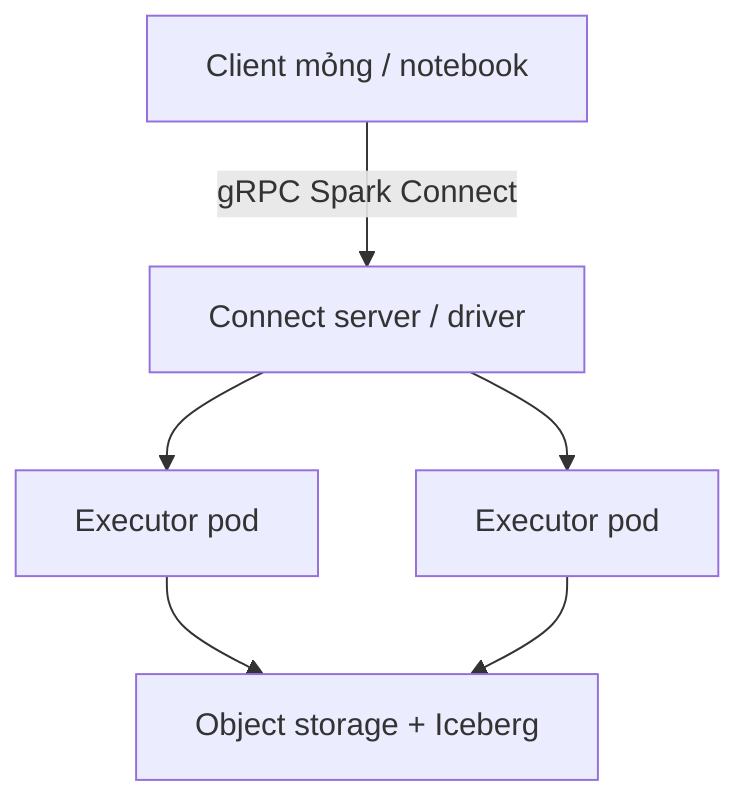

Phần lý thuyết bắt buộc trình bày kiến trúc driver, executor, RDD và trình quản lý cụm (bao gồm Kubernetes). Bài tùy chọn này tập trung vào xu hướng **coi Spark như một dịch vụ từ xa**: kiến trúc Spark Connect (từ Spark 3.4) cùng mô hình client/server trên **Spark 4.0.0** (phát hành ngày 23/5/2025), đồng thời giải thích vì sao nhiều tổ chức giai đoạn 2022–2026 chọn chạy Spark trên Kubernetes thay vì duy trì cụm YARN thường trực.

> Lý thuyết bắt buộc hiện ở bản tiếng Anh. Đây là bài ứng dụng tùy chọn bằng tiếng Việt.

## Mục tiêu học tập

- Giải thích cơ chế của Spark Connect trong việc tách rời *tiến trình người dùng* và *session trên cụm* thông qua gRPC.
- Liệt kê các cải tiến đáng chú ý của Spark 4.0 cho client Connect (gói Python client gọn nhẹ, cấu hình `spark.api.mode`, hỗ trợ ML trên Connect).
- Xác định trường hợp mã nguồn dựa trên API RDD cũ cản trở quá trình chuyển sang Spark Connect.

## 1. Hạn chế của mô hình driver gắn chặt tiến trình người dùng

Trong kiến trúc Spark cổ điển, tiến trình JVM/Python của người dùng gắn trực tiếp vào luồng điều khiển cụm. Điều này gây ra nhiều bất tiện trong các hệ thống hiện đại:

- Các ứng dụng dữ liệu đa thuê bao và IDE không phù hợp để đóng gói trọn bộ PySpark nặng khoảng 200 MB.
- Môi trường notebook từ xa dễ bị ngắt phiên làm việc nếu tiến trình driver bị thu hồi tài nguyên đột ngột (preempt).
- Khó xây dựng client cho các ngôn ngữ không dựa trên nền tảng JVM.

Spark Connect giải quyết vấn đề này bằng cách chỉ gửi **kế hoạch truy vấn logic chưa phân giải (unresolved logical plan)** qua gRPC. Phía máy chủ đảm nhận bộ tối ưu Catalyst và engine thực thi Tungsten, còn phía client chỉ là một lớp stub gọn nhẹ. Theo tài liệu chính thức, các API mức thấp như RDD và `SparkContext` **không** được hỗ trợ qua Spark Connect — chỉ giao diện DataFrame và SQL hoạt động trên đường này.

```python
from pyspark.sql import SparkSession

spark = (
    SparkSession.builder
    .config("spark.api.mode", "connect")
    .remote("sc://spark-connect-server:15002")
    .getOrCreate()
)

df = spark.read.parquet("s3a://lab/events/")
df.groupBy("country").count().show()
```

Theo ghi chú phát hành Spark 4.0, các điểm đáng chú ý gồm: gói **`pyspark-client` chỉ khoảng 1,5 MB**, bản phân phối bật sẵn Connect, tương thích API client Java, hỗ trợ thư viện học máy (ML) trên Connect và mở rộng client cho nhiều ngôn ngữ mới (bao gồm Swift). Databricks Runtime 17.0 cũng tích hợp sẵn Spark 4.0 cho môi trường thực hành quản lý.

## 2. Vận hành Spark trên Kubernetes

Giai đoạn 2022–2026, các nhóm hạ tầng thường triển khai Spark dưới dạng **Pod** trên Kubernetes với các đặc điểm:

- Cô lập bộ driver và executor riêng cho từng tác vụ (hoặc chạy một Deployment Spark Connect sống dài hạn).
- Sử dụng `nodeSelector` để phân bổ máy ảo spot hoặc on-demand, cũng như nút có GPU cho pandas UDF hoặc PyTorch.
- Dùng chung hệ thống quan sát (OpenTelemetry, Prometheus) với các microservice khác trong cụm.

Kiến trúc lõi (driver/executor) vẫn giữ nguyên như phần lý thuyết, chỉ thay đổi **trình quản lý cụm (cluster manager)**. Tuy nhiên, quản lý dịch vụ shuffle và cấp phát tài nguyên động trên Kubernetes đòi hỏi cấu hình bổ sung ở tầng nền tảng ứng dụng thay vì chỉ thuộc trách nhiệm của quản trị viên Hadoop.



## 3. Ba mẫu kiến trúc ứng dụng tiêu biểu

1. **Phân tích tương tác:** Nhiều người dùng kết nối tới một điểm cuối Spark Connect chung, áp dụng phân quyền dữ liệu ở mức hàng ngay trên phía máy chủ.
2. **Tính toán đặc trưng định kỳ:** Kubernetes `CronJob` hoặc Airflow chỉ cần chứa client gọn nhẹ trong pipeline CI/CD để gửi tác vụ lên cụm.
3. **Spark nhúng trong kiến trúc dịch vụ:** Một microservice viết bằng Go hoặc Python gọi tới Spark để nối (join) tập dữ liệu 2 TB rồi nhận về tập kết quả tổng hợp nhỏ — theo tinh thần SOA, Spark lúc này là một *dịch vụ phụ thuộc*, không bao trùm toàn bộ ứng dụng.

<div class="content-box warning-box">
<p><strong>Lưu ý về bài tập RDD và Spark Connect.</strong> Nếu bài thực hành vẫn yêu cầu dùng <code>sc.parallelize</code> và quản lý phân vùng thủ công, bạn đang làm việc trên Spark Classic. Cách tiếp cận này hữu ích để hiểu cơ chế lineage, nhưng không phản ánh mặc định của các ứng dụng triển khai giai đoạn 2025 trở đi.</p>
</div>

## Thách thức

- Khoảng trống tương thích API trên Spark Connect, nhất là với mã nguồn cũ sử dụng RDD hoặc các thư viện ML kế thừa.
- Máy chủ Spark Connect dùng chung dễ gặp vấn đề tác động chéo về tài nguyên (noisy neighbor) và cần thiết lập ranh giới bảo mật chặt chẽ.
- Cấu hình lưu trữ cục bộ và dữ liệu shuffle trên Kubernetes phức tạp hơn so với mô hình locality gắn đĩa của HDFS.

## Video tham khảo

- **Xem trước:** [Spark Connect: Flexible, Local Access to Apache Spark at Scale](https://www.youtube.com/watch?v=Poz63cOyp-Q) — Databricks (tiếng Anh). Trình bày kiến trúc truy cập cụm từ xa của Spark Connect, giải quyết hạn chế của driver nặng.
- [What is Spark Connect and Getting started Spark Connect Hello World](https://www.youtube.com/watch?v=7sn_DgUMlMQ) — Soumil Shah (tiếng Anh). Ví dụ thực hành ngắn gọn giúp hình dung rõ cơ chế kết nối client/server.
- [What is Kubernetes?](https://www.youtube.com/watch?v=cC46cg5FFAM) — Google Cloud Tech (tiếng Anh). Giới thiệu Kubernetes — nền tảng điều phối cụm thay thế YARN trong nhiều hệ thống hiện đại.

## Bài tập

1. Dựa vào ghi chú phát hành Spark 4.0, liệt kê ba cải tiến của Spark Connect mang lại lợi ích trực tiếp cho các nhóm phát triển *không dùng JVM*.
2. Vẽ sơ đồ so sánh vị trí chạy bộ tối ưu Catalyst trong Spark Classic và trong Spark Connect.
3. Đề xuất phương án phân tách namespace và hạn mức tài nguyên (resource quota) để các tác vụ thực hành của sinh viên không chiếm dụng hết tài nguyên của Deployment Spark Connect dùng chung.

## Tài liệu tham khảo

1. Apache Spark, *Spark Release 4.0.0* (23/5/2025).
2. Apache Spark, *Spark Connect*: [spark.apache.org/spark-connect](https://spark.apache.org/spark-connect/).
3. Tài liệu Spark 4.0.0, *Spark Connect Overview*.
4. Blog Databricks, “Introducing Apache Spark 4.0”.
5. Apache Spark, *Running Spark on Kubernetes*.
