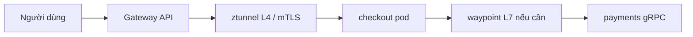

Khi hệ thống mới chỉ có 3 dịch vụ chạy trong Kubernetes, một đối tượng `Ingress` đơn giản và vài lời gọi HTTP nội bộ là quá đủ. Nhưng khi doanh nghiệp mở rộng lên 50 hay 200 microservice, hàng loạt câu hỏi hóc búa lập tức xuất hiện: làm sao chuyển đúng 5% lưu lượng người dùng thật sang phiên bản v2 để kiểm thử *canary*? Làm sao mã hóa toàn bộ lưu lượng nội bộ giữa các Pod (mTLS) và xoay chứng chỉ tự động mỗi 24 giờ mà lập trình viên không phải viết lại một dòng mã nào?

Bài học này mở khóa lớp **mạng ứng dụng (application networking)** hiện đại trên Kubernetes giai đoạn 2022–2026: **Gateway API** (chuẩn định tuyến kế nhiệm Ingress) và **Service Mesh** (từ kiến trúc sidecar truyền thống đến *ambient mesh* tối ưu tài nguyên).

## Kiến thức cần nhớ: Bốn mảnh ghép của lớp mạng dịch vụ trên Kubernetes

Để không bị choáng ngợp bởi hàng chục thuật ngữ như `HTTPRoute`, `Envoy`, `mTLS` hay `ztunnel`, hãy đặt chúng vào bốn trụ cột rõ ràng:

1. **Mặt phẳng điều khiển (Control Plane) vs. Mặt phẳng dữ liệu (Data Plane)**:
   Trong mọi hệ thống mạng hiện đại, **Control Plane** (như `istiod`) không trực tiếp chạm vào gói tin người dùng; nó chỉ đọc cấu hình YAML, cấp phát chứng chỉ số và đẩy luật định tuyến xuống **Data Plane** (proxy hiệu năng cao như Envoy hoặc ztunnel viết bằng Rust), nơi thực sự chuyển tiếp hàng trăm nghìn request mỗi giây.

2. **Gateway API & Tách bạch vai trò vận hành (Role-Oriented Routing)**:
   `Ingress` đời cũ nhồi nhét mọi cấu hình (chứng chỉ TLS, cân bằng tải, quy tắc rewrite URL, timeout) vào các *annotation* đặc thù của từng hãng. **Gateway API** tách rõ ba tầng tài nguyên: `GatewayClass` (nhà cung cấp hạ tầng), `Gateway` (đội vận hành mở cổng/TLS), và `HTTPRoute` / `GRPCRoute` (đội phát triển tự khai báo chia lưu lượng canary, lọc header, retry) với cùng một chuẩn YAML di động.

3. **mTLS (Mutual TLS) & Danh tính khối lượng công việc (SPIFFE)**:
   TLS thông thường chỉ xác thực máy chủ với trình duyệt. Trong mạng nội bộ Zero Trust, **mTLS** buộc *cả hai phía* (Pod gọi và Pod được gọi) xuất trình chứng chỉ X.509 ngắn hạn gắn liền với `ServiceAccount` của Pod, ngăn chặn tấn công nghe lén hoặc giả mạo dịch vụ ngay cả khi kẻ tấn công đã lọt vào trong mạng cụm.

4. **Sidecar Mesh vs. Ambient Mesh (Tách lớp L4 và L7)**:
   Mô hình sidecar gắn 1 container proxy (Envoy) vào *mỗi* Pod—đơn giản về mặt cô lập nhưng tốn rất nhiều RAM/CPU và gây lỗi khởi động tuần tự. **Ambient Mesh** tách riêng một daemon mỏng tầng L4 (`ztunnel`) chạy trên mỗi Node để lo mTLS cho mọi Pod, và chỉ bật **Waypoint proxy** tầng L7 cho những namespace thực sự cần chia tải HTTP/telemetry phức tạp.

## Mục tiêu học tập

- Hiểu cách Gateway API (`Gateway`, `HTTPRoute`, `GRPCRoute`) thay thế dần Ingress truyền thống để chuẩn hóa hợp đồng lưu lượng bắc–nam.
- So sánh kiến trúc service mesh dùng sidecar với chế độ ambient (`ztunnel` kết hợp proxy `waypoint` tùy chọn).
- Xác định khi nào chính sách mạng ở tầng CNI/eBPF đã đáp ứng đủ yêu cầu và khi nào cần đến chính sách tầng L7 của service mesh.

## 1. Gateway API: chuẩn định tuyến di động cho kiến trúc dịch vụ

Gateway API v1.0 (31/10/2023) chính thức chuẩn hóa `Gateway`, `GatewayClass` và `HTTPRoute`. Phiên bản v1.1 (9/5/2024) đưa thêm hỗ trợ **service mesh** (`HTTPRoute` gắn `parentRef` tới Service) và **GRPCRoute** vào kênh Standard, cho phép dùng chung một mô hình khai báo định tuyến cho cả lưu lượng bắc–nam (ingress) lẫn đông–tây (nội cụm).

```yaml
apiVersion: gateway.networking.k8s.io/v1
kind: HTTPRoute
metadata:
  name: checkout
spec:
  parentRefs:
    - name: edge-gateway
  rules:
    - matches:
        - path: { type: PathPrefix, value: /checkout }
      backendRefs:
        - name: checkout
          port: 8080
```

Điểm mạnh của mô hình này là phân tách rõ quyền sở hữu: nhóm ứng dụng quản lý tài nguyên *route*, còn nhóm hạ tầng nền tảng quản lý *Gateway*. Điều này khắc phục nhược điểm quản trị trước đây của Ingress vốn phụ thuộc vào nhiều chuỗi annotation đặc thù theo từng controller.

## 2. Ambient mesh: mTLS giảm chi phí vận hành của sidecar

Istio Ambient Mode (công bố năm 2022, **đạt chuẩn GA ở phiên bản 1.24** cuối năm 2024) tách lớp xử lý lưu lượng thành hai tầng: tầng L4 (mã hóa mTLS và định danh cơ bản) đặt tại tiến trình **ztunnel** chạy trên từng nút (node), còn các tính năng tầng L7 được kích hoạt tùy chọn qua proxy **waypoint**. Mục tiêu là cung cấp định danh mật mã và các chỉ số giám sát cơ bản mà *không* phải chèn container sidecar vào mọi Pod — vốn là nguyên nhân chính khiến nhiều nhóm e ngại chi phí vận hành của service mesh.

Cilium (cũng là dự án CNCF graduated) xử lý phần lớn lưu lượng L3/L4 trực tiếp trong nhân Linux bằng **eBPF** và có thể kết hợp Envoy khi cần tính năng L7. Tài liệu so sánh năm 2024 của Istio chỉ ra hai dự án thường được **kết hợp** cùng nhau: Cilium đảm nhận tầng CNI và NetworkPolicy, còn Istio đảm nhận định tuyến L7 và quản lý định danh; không nên xem hai công nghệ này là đối lập hoàn toàn.



## 3. Khi nào *không* nên triển khai service mesh

Nên cân nhắc service mesh khi hệ thống thực sự cần **định danh dịch vụ thống nhất** (như chuẩn SPIFFE), chính sách timeout/retry nhất quán hoặc phân quyền ở tầng L7 xuyên qua nhiều ngôn ngữ lập trình. Ngược lại, nếu hệ thống chỉ có vài dịch vụ nhỏ đứng sau một cổng vào, việc thêm mesh sẽ làm tăng độ phức tạp không cần thiết — xu hướng giảm từ 50% xuống 42% trong khảo sát CNCF phản ánh chính sự thận trọng này.

<div class="content-box warning-box">
<p><strong>Service mesh không thay thế hoàn toàn khả năng quan sát ứng dụng.</strong> Bạn vẫn cần tích hợp OpenTelemetry trong mã nguồn để ghi nhận các span mang ngữ cảnh nghiệp vụ. Tầng data plane cung cấp được các chỉ số mạng cơ bản (golden signals), nhưng không thể tự hiểu các thuộc tính nghiệp vụ như <code>order.id</code>.</p>
</div>

### Giải thích: Tính tay chi phí RAM & độ trễ của Sidecar Mesh so với Ambient Mesh trên cụm 200 Pod

Trước khi bật Service Mesh cho cụm Kubernetes, một kỹ sư hạ tầng luôn phải tính bài toán chi phí–lợi ích bằng con số cụ thể. Giả sử bạn có một cụm gồm **10 Node** chạy tổng cộng **200 Pod microservice**, trong đó chỉ có **4 nhóm dịch vụ** thực sự cần định tuyến L7 phức tạp (chia lưu lượng canary, retry theo mã HTTP), còn lại chỉ cần mã hóa mTLS tầng L4.

#### Bước 1: So sánh chi phí RAM của mặt phẳng dữ liệu (Data Plane)

- **Mô hình Sidecar truyền thống (1 Envoy proxy cho mỗi Pod)**:
  Mỗi Envoy sidecar tiêu tốn trung bình `65 MB` RAM (chưa kể bộ nhớ tăng thêm theo số lượng endpoint trong cụm):
  $$\text{RAM}_{\text{Sidecar}} = 200\text{ Pod} \times 65\text{ MB} = \mathbf{13.000\text{ MB}} \approx \mathbf{12{,}7\text{ GB RAM}}.$$
- **Mô hình Ambient Mesh (1 `ztunnel` L4 mỗi Node + 4 Waypoint proxy L7)**:
  Mỗi `ztunnel` (viết bằng Rust) tiêu tốn khoảng `25 MB` RAM/Node; mỗi Waypoint proxy L7 (chạy 2 bản sao để sẵn sàng cao = 8 Pod) tiêu tốn `70 MB` RAM:
  $$\text{RAM}_{\text{Ambient}} = (10 \times 25) + (8 \times 70) = 250 + 560 = \mathbf{810\text{ MB}} \approx \mathbf{0{,}79\text{ GB RAM}}.$$

Chênh lệch dễ thấy: Ambient Mesh cắt giảm hơn **$16\times$** lượng RAM dành cho lớp proxy (tiết kiệm gần **12 GB RAM**, tương đương 1–2 máy ảo đám mây mỗi tháng) mà vẫn phủ mTLS cho 100% Pod!

#### Bước 2: Trace 1 request Canary 90/10 qua `HTTPRoute` của Gateway API

Giả sử đội sản phẩm cấu hình `HTTPRoute` chia tải `weight: 90` cho `orders-v1` và `weight: 10` cho `orders-v2`, đồng thời đo độ trễ trên chuỗi gọi gồm `Gateway → Service A → Service B`:

| Thành phần trên đường đi của Request | Số hop proxy (Sidecar) | Độ trễ proxy cộng thêm (ước lượng p99) | Trải nghiệm người dùng |
| :--- | :---: | :---: | :--- |
| Gateway (`HTTPRoute` kiểm tra header/trọng số `90/10`) | 1 hop | $+1{,}5\text{ ms}$ | 90% request vào `v1`, 10% vào `v2` |
| `Service A` gửi ra (egress proxy) → `Service B` nhận vào (ingress proxy) | 2 hop | $+2 \times 1{,}2\text{ ms} = +2{,}4\text{ ms}$ | Tự động mã hóa mTLS & ghi span trace |
| **Tổng phụ phí độ trễ trên 1 chuỗi 2 dịch vụ** | **3 hop** | **$+3{,}9\text{ ms}$** | Chấp nhận được với web API (`100 ms`), nhưng cần cân nhắc nếu chuỗi gọi sâu 10 tầng (`+25 ms`) |

Nhờ tính tay hai bảng trên, bạn thấy ngay nguyên tắc vàng: **chỉ bật tầng L7 ở nơi thực sự cần**, và với hệ thống dưới 5 dịch vụ nội bộ đơn giản, một `Gateway` ở biên thường đã đủ sạch và rẻ hơn rất nhiều so với toàn bộ Service Mesh.

## Thách thức

- Tồn tại song song nhiều API quản lý lưu lượng trong cùng một cụm (Ingress cũ, Gateway API và `VirtualService` của Istio).
- Khi kết hợp Ambient Mode với CNI thay thế `kube-proxy`, cần cấu hình đúng các cờ tài liệu hóa để cơ chế cân bằng tải ở tầng socket không đi vòng qua mesh.
- Mức độ hỗ trợ `GRPCRoute` giữa các controller vẫn chậm hơn `HTTPRoute`, do đó cần kiểm tra ma trận tương thích trước khi áp dụng.

## Video tham khảo

- **Xem trước:** [Istio & Service Mesh - simply explained in 15 mins](https://www.youtube.com/watch?v=16fgzklcF7Y) — TechWorld with Nana (tiếng Anh). Giải thích tổng quan về service mesh trước khi tìm hiểu Ambient Mode.
- [The Differences between Ingress & Gateway API](https://www.youtube.com/watch?v=GhIrz-V9X6k) — That DevOps Guy (tiếng Anh). So sánh Ingress truyền thống với Gateway API.
- [What is Cilium?](https://www.youtube.com/watch?v=ELyib78vjRY) — eBPF & Cilium Community (tiếng Anh). Giới thiệu Cilium và tầng dữ liệu eBPF khi đặt cạnh Istio.

## Bài tập

1. Chuyển đổi một cấu hình YAML Ingress đơn giản sang cặp tài nguyên `Gateway` và `HTTPRoute`, sau đó nêu rõ nhóm nào nên sở hữu từng đối tượng.
2. Đối với một API thanh toán dùng gRPC, phân tích ưu và nhược điểm giữa việc định tuyến trực tiếp qua `GRPCRoute` so với chuyển đổi sang HTTP/JSON tại biên.
3. Dựa trên số liệu khảo sát CNCF 2024, viết một đoạn khuyến nghị ngắn cho hệ thống quy mô trường đại học gồm 15 dịch vụ: có nên triển khai service mesh ngay từ đầu hay không?

## Tài liệu tham khảo

1. Blog Kubernetes, “Gateway API v1.0: GA Release” (31/10/2023).
2. Blog Kubernetes, “Gateway API v1.1” (9/5/2024).
3. Istio, “Ambient Mode Reaches General Availability in v1.24”.
4. Istio, “Istio Ambient vs. Cilium” (2024).
5. CNCF *Cloud Native 2024 Annual Survey* (80% dùng Kubernetes; 42% dùng service mesh).
