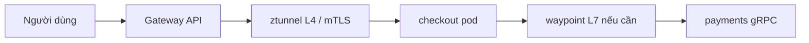

Phần bắt buộc của chương đã trình bày về Pod, Service và Deployment. Bài tùy chọn này đi vào lớp *mạng ứng dụng* giai đoạn 2022–2026 nằm phía trên: **Gateway API** (đạt chuẩn GA tháng 10/2023; bổ sung hỗ trợ mesh và `GRPCRoute` ở v1.1 tháng 5/2024), **Istio Ambient Mode** (GA trong Istio 1.24) và data plane dựa trên **eBPF** (Cilium). Khảo sát CNCF 2024 nêu một điểm rất đáng chú ý: dù Kubernetes rất phổ biến (**80%** dùng trong sản xuất), **tỷ lệ áp dụng service mesh trên môi trường sản xuất lại giảm từ 50% xuống 42%**. Điều này cho thấy chi phí độ phức tạp vận hành là yếu tố cần cân nhắc ngay từ đầu.

> Lý thuyết bắt buộc hiện ở bản tiếng Anh. Đây là bài ứng dụng tùy chọn bằng tiếng Việt.

## Mục tiêu học tập

- Hiểu cách Gateway API (`Gateway`, `HTTPRoute`, `GRPCRoute`) thay thế dần Ingress truyền thống để chuẩn hóa hợp đồng lưu lượng bắc–nam.
- So sánh kiến trúc service mesh dùng sidecar với chế độ ambient (`ztunnel` kết hợp proxy `waypoint` tùy chọn).
- Xác định khi nào chính sách mạng ở tầng CNI/eBPF đã đáp ứng đủ yêu cầu và khi nào cần đến chính sách tầng L7 của service mesh.

## 1. Gateway API: chuẩn định tuyến di động cho kiến trúc dịch vụ

Gateway API v1.0 (31/10/2023) chính thức chuẩn hóa `Gateway`, `GatewayClass` và `HTTPRoute`. Phiên bản v1.1 (9/5/2024) đưa thêm hỗ trợ **service mesh** (`HTTPRoute` gắn `parentRef` tới Service) và **GRPCRoute** vào kênh Standard, cho phép dùng chung một mô hình khai báo định tuyến cho cả lưu lượng bắc–nam (ingress) lẫn đông–tây (nội cụm).

```yaml
apiVersion: gateway.networking.k8s.io/v1
kind: HTTPRoute
metadata:
  name: checkout
spec:
  parentRefs:
    - name: edge-gateway
  rules:
    - matches:
        - path: { type: PathPrefix, value: /checkout }
      backendRefs:
        - name: checkout
          port: 8080
```

Điểm mạnh của mô hình này là phân tách rõ quyền sở hữu: nhóm ứng dụng quản lý tài nguyên *route*, còn nhóm hạ tầng nền tảng quản lý *Gateway*. Điều này khắc phục nhược điểm quản trị trước đây của Ingress vốn phụ thuộc vào nhiều chuỗi annotation đặc thù theo từng controller.

## 2. Ambient mesh: mTLS giảm chi phí vận hành của sidecar

Istio Ambient Mode (công bố năm 2022, **đạt chuẩn GA ở phiên bản 1.24** cuối năm 2024) tách lớp xử lý lưu lượng thành hai tầng: tầng L4 (mã hóa mTLS và định danh cơ bản) đặt tại tiến trình **ztunnel** chạy trên từng nút (node), còn các tính năng tầng L7 được kích hoạt tùy chọn qua proxy **waypoint**. Mục tiêu là cung cấp định danh mật mã và các chỉ số giám sát cơ bản mà *không* phải chèn container sidecar vào mọi Pod — vốn là nguyên nhân chính khiến nhiều nhóm e ngại chi phí vận hành của service mesh.

Cilium (cũng là dự án CNCF graduated) xử lý phần lớn lưu lượng L3/L4 trực tiếp trong nhân Linux bằng **eBPF** và có thể kết hợp Envoy khi cần tính năng L7. Tài liệu so sánh năm 2024 của Istio chỉ ra hai dự án thường được **kết hợp** cùng nhau: Cilium đảm nhận tầng CNI và NetworkPolicy, còn Istio đảm nhận định tuyến L7 và quản lý định danh; không nên xem hai công nghệ này là đối lập hoàn toàn.



## 3. Khi nào *không* nên triển khai service mesh

Nên cân nhắc service mesh khi hệ thống thực sự cần **định danh dịch vụ thống nhất** (như chuẩn SPIFFE), chính sách timeout/retry nhất quán hoặc phân quyền ở tầng L7 xuyên qua nhiều ngôn ngữ lập trình. Ngược lại, nếu hệ thống chỉ có vài dịch vụ nhỏ đứng sau một cổng vào, việc thêm mesh sẽ làm tăng độ phức tạp không cần thiết — xu hướng giảm từ 50% xuống 42% trong khảo sát CNCF phản ánh chính sự thận trọng này.

<div class="content-box warning-box">
<p><strong>Service mesh không thay thế hoàn toàn khả năng quan sát ứng dụng.</strong> Bạn vẫn cần tích hợp OpenTelemetry trong mã nguồn để ghi nhận các span mang ngữ cảnh nghiệp vụ. Tầng data plane cung cấp được các chỉ số mạng cơ bản (golden signals), nhưng không thể tự hiểu các thuộc tính nghiệp vụ như <code>order.id</code>.</p>
</div>

## Thách thức

- Tồn tại song song nhiều API quản lý lưu lượng trong cùng một cụm (Ingress cũ, Gateway API và `VirtualService` của Istio).
- Khi kết hợp Ambient Mode với CNI thay thế `kube-proxy`, cần cấu hình đúng các cờ tài liệu hóa để cơ chế cân bằng tải ở tầng socket không đi vòng qua mesh.
- Mức độ hỗ trợ `GRPCRoute` giữa các controller vẫn chậm hơn `HTTPRoute`, do đó cần kiểm tra ma trận tương thích trước khi áp dụng.

## Video tham khảo

- **Xem trước:** [Istio & Service Mesh - simply explained in 15 mins](https://www.youtube.com/watch?v=16fgzklcF7Y) — TechWorld with Nana (tiếng Anh). Giải thích tổng quan về service mesh trước khi tìm hiểu Ambient Mode.
- [The Differences between Ingress & Gateway API](https://www.youtube.com/watch?v=GhIrz-V9X6k) — That DevOps Guy (tiếng Anh). So sánh Ingress truyền thống với Gateway API.
- [What is Cilium?](https://www.youtube.com/watch?v=ELyib78vjRY) — eBPF & Cilium Community (tiếng Anh). Giới thiệu Cilium và tầng dữ liệu eBPF khi đặt cạnh Istio.

## Bài tập

1. Chuyển đổi một cấu hình YAML Ingress đơn giản sang cặp tài nguyên `Gateway` và `HTTPRoute`, sau đó nêu rõ nhóm nào nên sở hữu từng đối tượng.
2. Đối với một API thanh toán dùng gRPC, phân tích ưu và nhược điểm giữa việc định tuyến trực tiếp qua `GRPCRoute` so với chuyển đổi sang HTTP/JSON tại biên.
3. Dựa trên số liệu khảo sát CNCF 2024, viết một đoạn khuyến nghị ngắn cho hệ thống quy mô trường đại học gồm 15 dịch vụ: có nên triển khai service mesh ngay từ đầu hay không?

## Tài liệu tham khảo

1. Blog Kubernetes, “Gateway API v1.0: GA Release” (31/10/2023).
2. Blog Kubernetes, “Gateway API v1.1” (9/5/2024).
3. Istio, “Ambient Mode Reaches General Availability in v1.24”.
4. Istio, “Istio Ambient vs. Cilium” (2024).
5. CNCF *Cloud Native 2024 Annual Survey* (80% dùng Kubernetes; 42% dùng service mesh).
