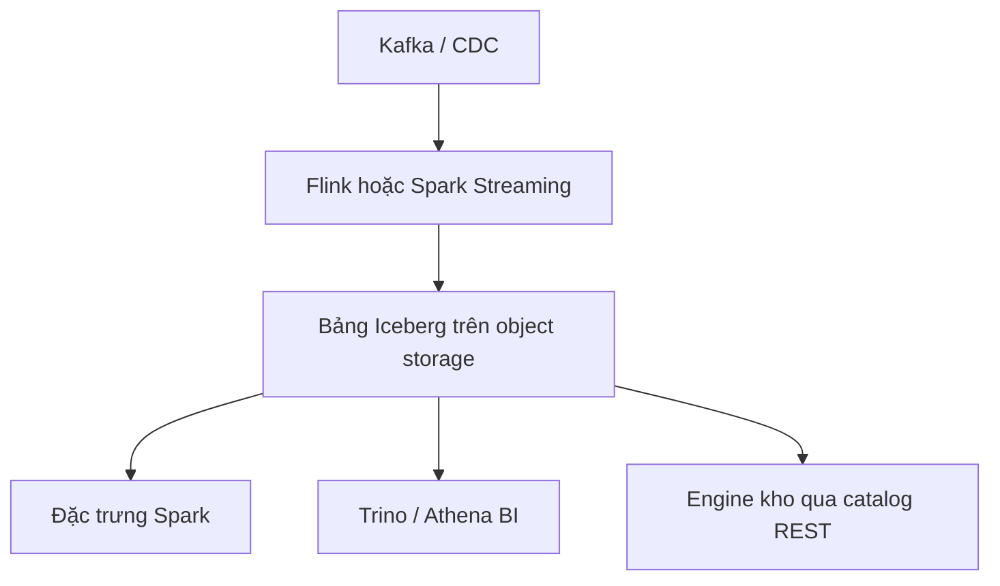

Suốt hơn một thập kỷ, các doanh nghiệp dữ liệu lớn bị kẹt trong một thế lưỡng nan đắt đỏ: lưu dữ liệu thô trên **Data Lake** (rẻ, linh hoạt trên S3/GCS nhưng hỗn loạn, thiếu giao dịch ACID, dễ thành "đầm lầy dữ liệu"), rồi mỗi đêm phải chạy hàng trăm đường ống ETL sao chép sang **Data Warehouse** (nhanh, chuẩn SQL, có ACID nhưng đắt đỏ và khóa chặt vào một nhà cung cấp).

Kiến trúc **Open Lakehouse**—với các định dạng bảng mở như **Apache Iceberg**, **Delta Lake** và **Apache Hudi**—đã phá vỡ ranh giới đó. Thay vì nhốt dữ liệu trong định dạng độc quyền của một kho dữ liệu duy nhất, hợp đồng nền tảng nay dịch chuyển xuống chính **tầng bảng mở** nằm ngay trên Object Storage giá rẻ, cho phép Spark, Trino, DuckDB, Snowflake và BigQuery cùng đọc ghi an toàn trên một bản dữ liệu duy nhất.

## Kiến thức cần nhớ: Bốn viên gạch công nghệ tạo nên Open Lakehouse

Để hiểu vì sao các định dạng bảng mở lại thay đổi toàn bộ ngành kỹ thuật dữ liệu giai đoạn 2022–2026, hãy nắm bốn trụ cột sau:

1. **Lưu trữ dạng cột (Columnar Storage — Apache Parquet)**:
   Thay vì lưu từng dòng liền nhau như CSV/JSON, Parquet gom giá trị của *cùng một cột* vào các khối liên tiếp (row groups). Nhờ đó, câu truy vấn chỉ cần 3 cột trong bảng 100 cột sẽ bỏ qua hoàn toàn 97 cột còn lại, đồng thời nén dữ liệu cùng kiểu hiệu quả hơn gấp $5\times\text{–}10\times$.

2. **Tầng Metadata giao dịch ACID (Iceberg / Delta Transaction Log)**:
   Object Storage (như S3) vốn chỉ cung cấp các tệp bất biến và không hỗ trợ giao dịch nhiều tệp cùng lúc. Iceberg/Delta giải quyết điều này bằng một cây tệp metadata (manifest list → manifest files → data files) và cơ chế hoán đổi con trỏ nguyên tử (*atomic catalog commit*). Mọi thao tác `INSERT`, `UPDATE`, `DELETE` đều tạo ra một **Snapshot** mới hoàn chỉnh, giúp người đọc không bao giờ thấy dữ liệu ghi dở dang.

3. **Tách rời hoàn toàn lưu trữ và tính toán (Decoupled Compute & Storage)**:
   Vì dữ liệu nằm ở định dạng mở (Parquet + Iceberg metadata) trên Object Storage, bạn có thể dùng **Apache Flink** để ghi luồng thời gian thực, **Spark** để huấn luyện ML ban đêm, và **DuckDB/Trino** để phân tích BI tức thì—tất cả đọc chung đúng một nguồn sự thật mà không cần sao chép ETL qua lại.

4. **Du hành thời gian (Time Travel) & Tiến hóa lược đồ (Schema Evolution)**:
   Nhờ lưu lịch sử các Snapshot bất biến, kỹ sư có thể truy vấn `SELECT * FROM orders VERSION AS OF 42` để tái lập chính xác tập dữ liệu huấn luyện mô hình AI tháng trước hoặc khôi phục tức thì nếu một job ghi nhầm dữ liệu.

## Mục tiêu học tập

- Hiểu nguyên lý "ghi một lần, đọc bằng nhiều engine" ở tầm kiến trúc nền tảng thay vì chỉ là chi tiết định dạng tệp.
- Đặt catalog REST (như Apache Polaris hoặc Iceberg REST Catalog) vào đúng vị trí trong kiến trúc nhiều lớp: thu thập (ingestion) – lưu trữ – xử lý – truy vấn.
- So sánh kiến trúc lakehouse hỗ trợ đồng thời lô và luồng với nền tảng kho dữ liệu độc quyền.

## 1. Hợp đồng nền tảng dịch chuyển sang tầng bảng mở

Nếu hợp đồng nền tảng Hadoop năm 2015 xoay quanh "HDFS + Hive Metastore + YARN", thì mô hình phổ biến năm 2025 được tổ chức thành bốn lớp tách biệt:

1. **Object storage** (S3, GCS, ADLS) đóng vai trò tầng lưu trữ bền vững.
2. **Định dạng bảng mở** (Iceberg, Delta Lake, Hudi) cung cấp quản lý snapshot, tiến hóa lược đồ (schema evolution) và thao tác xóa dữ liệu.
3. **Catalog** triển khai chuẩn Iceberg REST Catalog để Spark, Trino và Flink cùng nhìn thấy một trạng thái bảng thống nhất.
4. **Engine tính toán** có thể thay đổi hoặc kết hợp linh hoạt mà không cần sao chép hàng petabyte dữ liệu.

Năm 2024, Snowflake đóng góp **Polaris** (catalog REST cho Iceberg) cho Apache Software Foundation; cùng năm, Databricks mua lại Tabular (nhóm sáng lập Iceberg) và phát hành **Delta UniForm** giúp bảng Delta xuất siêu dữ liệu tương thích Iceberg. Bài phân tích kỹ thuật năm 2025 của Capital One gọi xu hướng này là *sự hội tụ định dạng*: kiến trúc sư dữ liệu ngày nay cần thiết kế sẵn cho kịch bản nhiều engine cùng đọc một nguồn dữ liệu.

Khảo sát hệ sinh thái Iceberg năm 2025 (công bố đầu năm 2026) ghi nhận Iceberg là định dạng bảng mở được nhắc đến nhiều nhất trong *mẫu khảo sát đó*, trong khi lớp catalog vẫn còn phân mảnh (AWS Glue, Nessie, S3 Tables, Polaris...). Nên xem kết quả khảo sát như *tín hiệu về xu hướng*, không phải con số thị phần tuyệt đối.

## 2. Ứng dụng: phân tích đa đám mây không cần thêm lớp ETL sao chép



Giá trị cốt lõi của mô hình nằm ở tầng ứng dụng phân tích sản phẩm, không phụ thuộc vào một hãng cơ sở dữ liệu cụ thể. Cơ chế quản trị (ai có quyền xóa snapshot, vùng nào lưu dữ liệu định danh cá nhân PII) được kiểm soát tập trung tại catalog và IAM, khớp với nội dung quản trị dữ liệu của phần lý thuyết.

```sql
SELECT country, count(*) AS n
FROM lake.events
WHERE event_date BETWEEN DATE '2026-09-01' AND DATE '2026-09-07'
GROUP BY 1;
```

## 3. Kết hợp xử lý luồng và xử lý lô trên cùng một bảng

Kiến trúc Kappa xem dòng sự kiện là nguồn sự thật duy nhất. Trong thực hành lakehouse hiện đại, mô hình này thường được kết hợp linh hoạt: nhánh luồng thực hiện **ghi nối tiếp (append)**, còn nhánh lô chạy định kỳ để **nén tệp (compaction) và viết lại**, kèm tính năng quay ngược thời gian (time-travel) phục vụ kiểm toán. Cấu trúc vẫn bám sát bốn tầng nền tảng (thu thập, lưu trữ, xử lý, truy vấn) nhưng bảo đảm tính nguyên tử tốt hơn nhiều so với việc ghi trực tiếp vào thư mục thô dạng `/events/2026/09/16/`.

<div class="content-box insight-box">
<p><strong>Dữ liệu như một sản phẩm (Data as a Product).</strong> Một bảng Iceberg có đơn vị sở hữu rõ ràng, có SLO và nhật ký thay đổi lược đồ mang tính chất gần với một <em>dịch vụ</em> trong SOA hơn là một thư mục xuất dữ liệu rời rạc; khi đó catalog đóng vai trò tương đương service registry.</p>
</div>

### Giải thích: Tính tay lượng dữ liệu quét và chi phí đọc nhờ Partition Pruning + Thống kê Min/Max trên bảng Iceberg 10 TB

Tại sao một câu truy vấn SQL chạy trên bảng Lakehouse nặng **10 TB** lại có thể trả kết quả chỉ trong vài giây với chi phí vài xu, thay vì đọc hết 10 TB rồi treo hệ thống? Hãy tính tay từng bước cắt tỉa (pruning) của tầng metadata Iceberg!

Giả sử bảng `sales_events` có tổng dung lượng **10 TB** (`10.000 GB`), lưu dữ liệu giao dịch trong **1.000 ngày** (trung bình `10 GB/ngày`), được phân vùng ẩn (*hidden partitioning*) theo ngày `event_date` và chứa **100 tệp Parquet** (`100 MB/tệp`) cho mỗi ngày. Mỗi tệp Parquet gồm 20 cột đều nhau (mỗi cột chiếm $5\%$ dung lượng tệp).

Ta chạy câu truy vấn phân tích:
```sql
SELECT store_id, SUM(amount)
FROM sales_events
WHERE event_date = DATE '2026-10-15'
  AND amount > 5000000;
```

Theo dõi lượng dữ liệu thực sự phải tải từ Object Storage qua 3 tầng cắt tỉa:

| Tầng cắt tỉa của Lakehouse | Cơ chế áp dụng | Dữ liệu còn lại phải đọc | Tỷ lệ giảm so với 10 TB |
| :--- | :--- | :---: | :---: |
| **0. Quét thô (không tối ưu)** | Đọc toàn bộ 100.000 tệp | `10.000 GB` | $1\times$ |
| **1. Partition Pruning (Manifest List)** | Chỉ giữ phân vùng `event_date = 2026-10-15` (1/1.000 ngày = 100 tệp) | `10 GB` | Giảm **$1.000\times$** |
| **2. Min/Max Stats Pruning (Manifest File)** | Metadata ghi sẵn `[min(amount), max(amount)]` của từng tệp; chỉ 12/100 tệp có `max(amount) > 5.000.000` | $12 \times 100\text{ MB} = \mathbf{1{,}2\text{ GB}}$ | Giảm **$8.333\times$** |
| **3. Column Projection (Parquet)** | Câu SQL chỉ cần 2/20 cột (`store_id`, `amount` = $10\%$ mỗi tệp) | $10\% \times 1{,}2\text{ GB} = \mathbf{120\text{ MB}}$ | Giảm **$83.333\times$** |

**Kiểm tra bằng chi phí thực tế** (với giá quét dữ liệu serverless phổ biến khoảng `$5 / TB`):
- Nếu quét thô 10 TB: $10 \times \$5 = \mathbf{\$50{,}00}$ cho **một** câu truy vấn!
- Sau 3 tầng cắt tỉa của Open Lakehouse (`0,00012 TB`): $0{,}00012 \times \$5 = \mathbf{\$0{,}0006}$ (chưa đến **15 đồng Việt Nam**!) và đọc xong `120 MB` trong dưới 1 giây.

Đó là sức mạnh toán học thực sự phía sau cấu trúc cây metadata của Apache Iceberg và Delta Lake.

## Thách thức

- Phân mảnh ở lớp catalog: vận hành hai catalog REST độc lập dễ dẫn đến hai phiên bản trạng thái dữ liệu khác nhau.
- Phát sinh quá nhiều tệp nhỏ nếu luồng nạp dữ liệu thời gian thực không đi kèm tác vụ nén tệp định kỳ.
- Chi phí truyền dữ liệu ra ngoài (*egress*) xuyên đám mây khi bảng dùng định dạng "mở" nhưng dữ liệu vật lý vẫn nằm trong bucket của một nhà cung cấp duy nhất.

## Video tham khảo

- **Xem trước:** [What is Apache Iceberg?](https://www.youtube.com/watch?v=6tjSVXpHrE8) — IBM Technology (tiếng Anh). Giải thích Apache Iceberg — định dạng bảng mở thay thế mô hình HDFS kết hợp Hive truyền thống.
- [Apache Iceberg: What It Is and Why Everyone’s Talking About It.](https://www.youtube.com/watch?v=TsmhRZElPvM) — Confluent Developer (tiếng Anh). Phân tích lý do Iceberg hỗ trợ tốt mô hình đa engine.
- [Lambda vs Kappa vs Data Streaming Platform — Which One Wins? \| Modern Data Engineering Pipelines](https://www.youtube.com/watch?v=vOYpLg5uB2g) — Confluent Developer (tiếng Anh). So sánh xử lý lô và xử lý luồng trên cùng một nền tảng dữ liệu.

## Bài tập

1. Ánh xạ từng thành phần của cặp Hive Metastore + HDFS sang cặp Iceberg REST Catalog + object storage, đồng thời chỉ ra những dạng sự cố nào vẫn còn tồn tại.
2. Thiết kế quy tắc quản trị cho một bảng chứa dữ liệu PII: snapshot nào được phép rời khỏi vùng Việt Nam/EU và những engine nào có quyền đọc?
3. Giải thích vì sao một tổ chức có thể dùng Flink cho nhánh nạp dữ liệu thời gian thực và dùng Spark cho nhánh backfill trên *cùng một* bảng Iceberg.

## Tài liệu tham khảo

1. Apache Iceberg: [iceberg.apache.org](https://iceberg.apache.org/).
2. Databricks, “Delta UniForm”.
3. Capital One Tech, “Lakehouse Convergence: Delta Lake & Iceberg” (2025).
4. Data Lakehouse Hub, kết quả khảo sát Iceberg 2025 (2/2026).
5. Tài liệu sink Apache Flink + Iceberg (mẫu nạp dữ liệu streaming).
