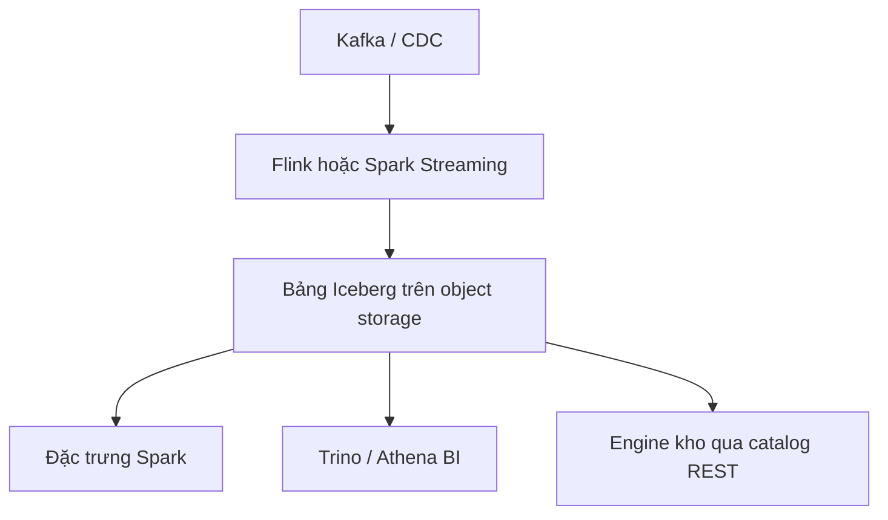

Phần bắt buộc của chương đã trình bày kiến trúc nền tảng dữ liệu lớn, pipeline và mô hình xử lý Lambda/Kappa. Bài tùy chọn này đi vào mô hình **lakehouse mở** giai đoạn 2022–2026: lưu trữ một bản sao dữ liệu duy nhất trên object storage, quản lý siêu dữ liệu bằng định dạng bảng mở (**Iceberg, Delta Lake, Hudi**) và cho phép nhiều engine (Spark, Flink, Trino, kho dữ liệu SaaS) truy cập chung thông qua **catalog REST**.

> Lý thuyết bắt buộc hiện ở bản tiếng Anh. Đây là bài ứng dụng tùy chọn bằng tiếng Việt.

## Mục tiêu học tập

- Hiểu nguyên lý "ghi một lần, đọc bằng nhiều engine" ở tầm kiến trúc nền tảng thay vì chỉ là chi tiết định dạng tệp.
- Đặt catalog REST (như Apache Polaris hoặc Iceberg REST Catalog) vào đúng vị trí trong kiến trúc nhiều lớp: thu thập (ingestion) – lưu trữ – xử lý – truy vấn.
- So sánh kiến trúc lakehouse hỗ trợ đồng thời lô và luồng với nền tảng kho dữ liệu độc quyền.

## 1. Hợp đồng nền tảng dịch chuyển sang tầng bảng mở

Nếu hợp đồng nền tảng Hadoop năm 2015 xoay quanh "HDFS + Hive Metastore + YARN", thì mô hình phổ biến năm 2025 được tổ chức thành bốn lớp tách biệt:

1. **Object storage** (S3, GCS, ADLS) đóng vai trò tầng lưu trữ bền vững.
2. **Định dạng bảng mở** (Iceberg, Delta Lake, Hudi) cung cấp quản lý snapshot, tiến hóa lược đồ (schema evolution) và thao tác xóa dữ liệu.
3. **Catalog** triển khai chuẩn Iceberg REST Catalog để Spark, Trino và Flink cùng nhìn thấy một trạng thái bảng thống nhất.
4. **Engine tính toán** có thể thay đổi hoặc kết hợp linh hoạt mà không cần sao chép hàng petabyte dữ liệu.

Năm 2024, Snowflake đóng góp **Polaris** (catalog REST cho Iceberg) cho Apache Software Foundation; cùng năm, Databricks mua lại Tabular (nhóm sáng lập Iceberg) và phát hành **Delta UniForm** giúp bảng Delta xuất siêu dữ liệu tương thích Iceberg. Bài phân tích kỹ thuật năm 2025 của Capital One gọi xu hướng này là *sự hội tụ định dạng*: kiến trúc sư dữ liệu ngày nay cần thiết kế sẵn cho kịch bản nhiều engine cùng đọc một nguồn dữ liệu.

Khảo sát hệ sinh thái Iceberg năm 2025 (công bố đầu năm 2026) ghi nhận Iceberg là định dạng bảng mở được nhắc đến nhiều nhất trong *mẫu khảo sát đó*, trong khi lớp catalog vẫn còn phân mảnh (AWS Glue, Nessie, S3 Tables, Polaris...). Nên xem kết quả khảo sát như *tín hiệu về xu hướng*, không phải con số thị phần tuyệt đối.

## 2. Ứng dụng: phân tích đa đám mây không cần thêm lớp ETL sao chép



Giá trị cốt lõi của mô hình nằm ở tầng ứng dụng phân tích sản phẩm, không phụ thuộc vào một hãng cơ sở dữ liệu cụ thể. Cơ chế quản trị (ai có quyền xóa snapshot, vùng nào lưu dữ liệu định danh cá nhân PII) được kiểm soát tập trung tại catalog và IAM, khớp với nội dung quản trị dữ liệu của phần lý thuyết.

```sql
SELECT country, count(*) AS n
FROM lake.events
WHERE event_date BETWEEN DATE '2026-09-01' AND DATE '2026-09-07'
GROUP BY 1;
```

## 3. Kết hợp xử lý luồng và xử lý lô trên cùng một bảng

Kiến trúc Kappa xem dòng sự kiện là nguồn sự thật duy nhất. Trong thực hành lakehouse hiện đại, mô hình này thường được kết hợp linh hoạt: nhánh luồng thực hiện **ghi nối tiếp (append)**, còn nhánh lô chạy định kỳ để **nén tệp (compaction) và viết lại**, kèm tính năng quay ngược thời gian (time-travel) phục vụ kiểm toán. Cấu trúc vẫn bám sát bốn tầng nền tảng (thu thập, lưu trữ, xử lý, truy vấn) nhưng bảo đảm tính nguyên tử tốt hơn nhiều so với việc ghi trực tiếp vào thư mục thô dạng `/events/2026/09/16/`.

<div class="content-box insight-box">
<p><strong>Dữ liệu như một sản phẩm (Data as a Product).</strong> Một bảng Iceberg có đơn vị sở hữu rõ ràng, có SLO và nhật ký thay đổi lược đồ mang tính chất gần với một <em>dịch vụ</em> trong SOA hơn là một thư mục xuất dữ liệu rời rạc; khi đó catalog đóng vai trò tương đương service registry.</p>
</div>

## Thách thức

- Phân mảnh ở lớp catalog: vận hành hai catalog REST độc lập dễ dẫn đến hai phiên bản trạng thái dữ liệu khác nhau.
- Phát sinh quá nhiều tệp nhỏ nếu luồng nạp dữ liệu thời gian thực không đi kèm tác vụ nén tệp định kỳ.
- Chi phí truyền dữ liệu ra ngoài (*egress*) xuyên đám mây khi bảng dùng định dạng "mở" nhưng dữ liệu vật lý vẫn nằm trong bucket của một nhà cung cấp duy nhất.

## Video tham khảo

- **Xem trước:** [What is Apache Iceberg?](https://www.youtube.com/watch?v=6tjSVXpHrE8) — IBM Technology (tiếng Anh). Giải thích Apache Iceberg — định dạng bảng mở thay thế mô hình HDFS kết hợp Hive truyền thống.
- [Apache Iceberg: What It Is and Why Everyone’s Talking About It.](https://www.youtube.com/watch?v=TsmhRZElPvM) — Confluent Developer (tiếng Anh). Phân tích lý do Iceberg hỗ trợ tốt mô hình đa engine.
- [Lambda vs Kappa vs Data Streaming Platform — Which One Wins? \| Modern Data Engineering Pipelines](https://www.youtube.com/watch?v=vOYpLg5uB2g) — Confluent Developer (tiếng Anh). So sánh xử lý lô và xử lý luồng trên cùng một nền tảng dữ liệu.

## Bài tập

1. Ánh xạ từng thành phần của cặp Hive Metastore + HDFS sang cặp Iceberg REST Catalog + object storage, đồng thời chỉ ra những dạng sự cố nào vẫn còn tồn tại.
2. Thiết kế quy tắc quản trị cho một bảng chứa dữ liệu PII: snapshot nào được phép rời khỏi vùng Việt Nam/EU và những engine nào có quyền đọc?
3. Giải thích vì sao một tổ chức có thể dùng Flink cho nhánh nạp dữ liệu thời gian thực và dùng Spark cho nhánh backfill trên *cùng một* bảng Iceberg.

## Tài liệu tham khảo

1. Apache Iceberg: [iceberg.apache.org](https://iceberg.apache.org/).
2. Databricks, “Delta UniForm”.
3. Capital One Tech, “Lakehouse Convergence: Delta Lake & Iceberg” (2025).
4. Data Lakehouse Hub, kết quả khảo sát Iceberg 2025 (2/2026).
5. Tài liệu sink Apache Flink + Iceberg (mẫu nạp dữ liệu streaming).
