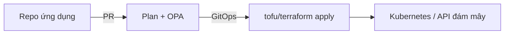

Phần bắt buộc của chương giới thiệu IaC khai báo, quản lý resource/state trong Terraform và công cụ cấu hình Ansible. Bài tùy chọn này bổ sung ba diễn biến thực tiễn giai đoạn 2023–2026: **sự kiện thay đổi giấy phép tháng 8/2023** (Terraform chuyển sang BSL và sự ra đời của **OpenTofu** theo giấy phép MPL 2.0 thuộc Linux Foundation), kiểm tra **chính sách dưới dạng mã (Policy as Code)** trước khi áp dụng thay đổi, và **platform engineering** với các module hạ tầng chuẩn hóa.

> Lý thuyết bắt buộc hiện ở bản tiếng Anh. Đây là bài ứng dụng tùy chọn bằng tiếng Việt.

## Mục tiêu học tập

- Trình bày sự kiện ngày 10/8/2023 và bối cảnh ra đời của OpenTofu 1.6 (tháng 1/2024).
- Viết quy tắc kiểm tra kiểu OPA/Conftest để ngăn lệnh `apply` vô tình tạo kho lưu trữ công khai.
- Hiểu vai trò của kho module chuẩn hóa do nhóm nền tảng cung cấp dưới góc nhìn kiến trúc dịch vụ nội bộ.

## 1. Hai công cụ CLI, cùng một nền tảng HCL

Ngày 10/8/2023, HashiCorp chuyển Terraform từ phiên bản 1.6 trở đi sang giấy phép **Business Source License (BSL) 1.1** (không thuộc nhóm giấy phép nguồn mở được OSI phê duyệt). Một liên minh doanh nghiệp và cộng đồng đã tạo nhánh từ phiên bản 1.5.x, công bố tuyên ngôn OpenTF và thành lập dự án **OpenTofu** dưới sự bảo trợ của Linux Foundation (gia nhập tháng 9/2023; phát hành bản **1.6.0 ổn định ngày 10/1/2024**). Trong sử dụng hằng ngày, lệnh `tofu` tương thích phần lớn với cấu hình HCL và các provider sẵn có, đồng thời bổ sung một số tính năng riêng như mã hóa tệp state tích hợp sẵn. Thương vụ IBM mua lại HashiCorp (giai đoạn 2024–2025) cũng là một mốc quan trọng về quản trị hệ sinh thái mà sinh viên cần nắm.

**Định hướng học tập:** Trọng tâm là nắm vững *nguyên lý cốt lõi* (state, plan, provider). Trong bài lab, bạn có thể dùng `terraform` hoặc `tofu` đều phù hợp; còn trong doanh nghiệp, bộ phận pháp chế và nền tảng sẽ quyết định công cụ chính thức.

```hcl
resource "aws_s3_bucket" "raw" {
  bucket = "iuh-lab-raw-${var.env}"
}
```

## 2. Chính sách dưới dạng mã: lớp kiểm duyệt tự động cho hạ tầng

Viết hạ tầng dưới dạng mã không tự động đảm bảo hạ tầng đó *an toàn*. Các công cụ chính sách như Open Policy Agent (OPA), Sentinel hoặc Checkov cho phép kiểm tra tự động bản kế hoạch thay đổi (**JSON plan**) trước khi chạy `apply`.

```rego
package terraform.s3

deny[msg] {
  some rc
  rc := input.resource_changes[_]
  rc.type == "aws_s3_bucket_public_access_block"
  rc.change.after.block_public_acls == false
  msg := sprintf("%s cho phép ACL công cộng", [rc.address])
}
```

Cơ chế này tương đồng với *admission controller* trong Kubernetes: lập trình viên khai báo hạ tầng mong muốn, còn nền tảng tự động thực thi các ràng buộc về vùng lưu trữ dữ liệu, gắn thẻ chi phí (FinOps) và mã hóa.

## 3. Platform engineering: cung cấp IaC như sản phẩm nội bộ

Từ năm 2024 trở đi, nhiều tổ chức hạn chế cấp tài khoản đám mây thô cho từng nhóm ứng dụng. Thay vào đó, **nhóm kỹ thuật nền tảng (platform team)** xây dựng và cung cấp:

- Các module chuẩn hóa có quản lý phiên bản (golden modules, ví dụ `eks-cluster/v4`, `postgres/v2`).
- Lộ trình phát triển tiêu chuẩn (paved road) kết hợp cổng nội bộ (như Backstage), GitOps và kiểm tra OPA.
- Cam kết SLO nội bộ, chẳng hạn thời gian tạo mới một môi trường xem trước (preview environment).

Khảo sát CNCF 2024 ghi nhận sự gia tăng mạnh của CI/CD và GitOps: IaC đảm nhận phần *định nghĩa hạ tầng*, Git là *kênh phân phối cấu hình*, còn cụm điều phối (Chương 09) là *môi trường chạy*. Kiến trúc đa đám mây (Chương 12) lúc này được trừu tượng hóa thành các provider khác nhau đứng sau cùng một giao diện module, thay vì sao chép rời rạc nhiều kho mã nguồn.



<div class="content-box insight-box">
<p><strong>Quản lý state vẫn là bài toán cốt lõi.</strong> Dù tệp state được OpenTofu mã hóa hay lưu trên HCP Terraform, rủi ro cơ bản trong phần lý thuyết vẫn giữ nguyên: hai tiến trình ghi đồng thời vào cùng một tệp state mà không có cơ chế khóa (state locking) sẽ gây xung đột và sai lệch trạng thái (split-brain).</p>
</div>

## Thách thức

- Nguy cơ phân mảnh kho provider, registry và lockfile khi hai hệ sinh thái tiến hóa độc lập.
- Bài toán cân bằng giữa việc cố định phiên bản module để ổn định với nhu cầu cập nhật nhanh bản vá bảo mật.
- Bộ quy tắc chính sách quá cứng nhắc có thể vô tình chặn cả những bài thử nghiệm hợp lệ trong môi trường học tập.

## Video tham khảo

- **Xem trước:** [What is OpenTofu Project?](https://www.youtube.com/watch?v=J2JKxY2elSo) — Oleksiy Pototskyy (tiếng Anh). Giới thiệu dự án OpenTofu và mối quan hệ với Terraform.
- [OPA Rego Tutorial: Write and Test Policy as Code](https://www.youtube.com/watch?v=x_IfmWXlHbI) — Spacelift (tiếng Anh). Hướng dẫn viết và kiểm thử chính sách bằng ngôn ngữ Rego cho mục Policy as Code.
- [What is a Platform Engineer?](https://www.youtube.com/watch?v=q6vbxk3hq-o) — HashiCorp, an IBM Company (tiếng Anh). Giải thích vai trò của kỹ sư nền tảng và cách cung cấp hạ tầng như sản phẩm nội bộ.

## Bài tập

1. Viết một quy tắc chính sách OPA yêu cầu mọi tài nguyên hạ tầng đều phải khai báo đầy đủ hai thẻ `tags.owner` và `tags.cost_center`.
2. Viết một đoạn ngắn phân tích vì sao sự khác biệt giữa giấy phép BSL và MPL tác động lớn đến các *nhà cung cấp dịch vụ SaaS* xây dựng sản phẩm quanh IaC, trong khi ít ảnh hưởng đến sinh viên chỉ chạy `apply` tạo một máy ảo thử nghiệm.
3. Thiết kế giao diện (biến đầu vào, giá trị đầu ra và giới hạn trần chi phí) cho một module chuẩn hóa phục vụ "môi trường preview cho đồ án sinh viên".

## Tài liệu tham khảo

1. Dự án OpenTofu: [opentofu.org](https://opentofu.org/).
2. Thông báo chuyển giấy phép BSL của HashiCorp (10/8/2023) và ghi chú phát hành OpenTofu 1.6.0 (10/1/2024).
3. Open Policy Agent: [openpolicyagent.org](https://www.openpolicyagent.org/).
4. CNCF *Cloud Native 2024 Annual Survey* (xu hướng CI/CD và GitOps).
5. Bài Terraform bắt buộc trong chương — các khái niệm provider, resource và state vẫn là kiến thức tiên quyết.
